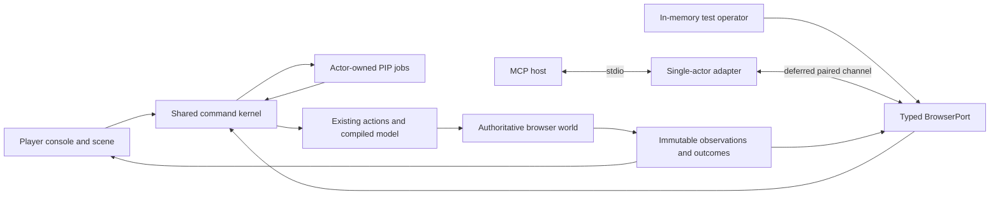

# Craft game: shared player–agent control over MCP

Date: 2026-10-29. Status: revised after two Distill rounds and realized as an offline shared runtime. The shared command boundary, actor policy, owned PIP jobs, observations, preview, cooperation console and nine tool handlers are implemented. The official SDK stdio adapter is tested against fixtures and the actual app/PIP logic; it has no active connection to the user’s tab. Consolidated results are in [VALIDATION.json](/home/vlad_/projects/cyberAlchemy-v2/goals/plans/craft-game-shared-mcp-2026-10-29/VALIDATION.json). Listener startup, registration, browser pairing and publication are not claimed. Local hosting, TDE and EVF remain deferred. Start with [IMPLEMENTATION-DAG.md](IMPLEMENTATION-DAG.md); critique and decisions live in [distill/RECONCILIATION.md](/home/vlad_/projects/cyberAlchemy-v2/goals/plans/craft-game-shared-mcp-2026-10-29/distill/RECONCILIATION.md). Open questions are owned below.

## Intended experience

The player operates the lab from the console while PIP collects parts, assembles equipment and connects cables. An agent can understand that same lab, explain available choices and request real PIP work. Its plan, progress, interruptions and results appear in the player's existing console. The player can inspect equipment, use either camera, stop the agent or take over. The agent cannot acknowledge lessons or claim the player understood them.

Three modes communicate authority: **Observe** reads and explains; **Suggest** adds an attributed draft for the player; **Assist** executes within a player-granted scope. Default to Observe on attachment. Build/wire/run-and-test is the initial optional Assist preset. Badge changes, work-order commands, resets, mission changes and archive actions have explicit separate scopes. A host's MCP approval behavior remains its own responsibility.

## Implementation and reused sources

The source root for this design is `release-candidates/craft-alchlang-current/public-source-repository/examples/engineering-game/lab/`, relative to this checkout.

| Source | Reused behavior | Role in the shared implementation |
|---|---|---|
| `app.js` | Real world mutations, typed cable/placement feedback, worker, saves and compiled operation calls | One commit boundary; pure observations; real collaboration versions; isolate shared-session saves |
| `tasks.js` | Visible PIP travel/action/wait stages, assembly, cables, equipment and blocked recovery | Actor and operation ownership; atomic plan admission; selective controls; retained outcomes |
| `tools.js` | Equipment discovery, compatible ports and console interactions | Original player controls use shared host commands; `shared-runtime.js` projects typed agent outcomes |
| `guide.js` | Twenty-five lessons with explanations and observed completion predicates | Pure agent-readable facts; preserve human-only acknowledgment |
| `world.js`, `scene3d.js` | Rooms, PIP position, Full lab / Follow PIP views and scene input | Route effects to the same service; keep presentation independent |
| `workshop.alch`, `profile.json`, `generated/manifest.json` | Actual business meaning, selected realization and generated identities | Link observations/actions to actual declarations and results |
| `game-mcp/` | Separate official SDK stdio adapter | Closed tool/resource forwarding to the trusted port; no private ARE/evolution capabilities |

The compiled workshop operations are `Workshop.InspectCatalog`, `Workshop.AnalyzeAssembly`, `Workshop.TestInterlock` and `Workshop.ApplyCommand`; nineteen original lesson operations are also embedded. The game now has a shared command kernel, an authenticated in-memory binding, actor-owned scheduler and an inactive stdio server package. An authenticated channel from an external host to the user’s existing tab remains deferred. Full-game browser checks and separate official SDK-to-runtime checks cover the offline integration; their tested boundaries are recorded separately in the consolidated report.

The implementation closes the original mutation gaps: public world captures are immutable, accepted changes publish real revision classes, assisted plans admit atomically, selective cancellation preserves foreign jobs, and retained operation receipts are separate from visual history. Pure observations evaluate generated operations on a clone. `openDevice()`, in-world `read_board` and `read_record` retain their gameplay effects; they are not substituted for pure tool reads.

## Scope and smallest useful unit

The first meaningful unit is **connect one existing typed output to one existing input through PIP, read the actual result and allow human interruption before commit**. It includes observation, preview, admission, visible execution, outcome recovery and takeover. The next unit installs a component and connects to its plan-local output. Remaining game actions extend that same loop.

The complete initial scope supports one authenticated adapter actor and one selected browser instance. A second attachment is refused explicitly. Agent plans require idle PIP, an empty queue, no foreign custody and a stopped/unowned experiment. Admit at most twelve logical actions, each lowering to exactly one staged job. Do not append agent work behind an uncertain queue prefix. Ordinary human queue use remains available and takes priority.

Multi-client brokers/IPC, queue-prefix prediction, remote sessions, durable crash replay, MCP Tasks and compiler-generated MCP profiles are follow-on work. Actor identity and the port boundary preserve room for those extensions.

## Architecture and authority

The browser owns the real live world. Neither the companion nor an adapter runs another simulation and presents it as the player's world. The in-memory operator is a functional test driver of the real command boundary, not evidence of live MCP attachment.

`GameCommandService` owns mutation admission and commits. Every effect route goes through it: direct canvas and console actions, fixtures, undo/reset/restore, PIP stages, simulation ticks and worker results, guide mutations and persistence selection. UI handlers become wrappers. Public getters return immutable copies. There is no agent tool for raw JavaScript, arbitrary paths/files, state replacement, camera changes or lesson acknowledgment.

A typed `BrowserPort` carries requests, results and event pages. Actor identity is injected by trusted binding context, never a model argument or `_meta.clientInfo`. One registry supplies action schemas, DTOs, scopes, handlers, effects, output bindings and provenance. Port and registry contracts are detailed in [CONTRACTS.md](CONTRACTS.md). [API.json](API.json) mirrors the current closed per-tool schemas emitted from the public example registry/contracts. The typed port, semantic validators, actor policy, operation ownership and tool dispatch are implemented. M02 routes existing UI/PIP effects through the shared service; `shared-runtime.js` composes the later offline capabilities around the same authoritative world.

## Craft and AlchLang responsibilities

Actual compiled operations remain the business decision source. Host geometry, PIP routing/custody, revisions, scopes, pairing and transport receipts are explicit host coordination; they must not be misrepresented as existing compiled Craft policy. Registry provenance distinguishes generated decisions, host checks and agent explanation. This scope adds no implementation profile or unsupported Alch syntax.

The existing simulated badge/Entry authorization and business eligibility remain separate from permission to let an MCP actor operate the game. Work-order replay identity such as C-23 is a business-model feature; MCP request identity is a different host concern. Neither replaces the other. Formal claims remain optional. No formal engine, TDE or EVF execution is included.

## Observations, bootstrap and meaning

Only `game_snapshot` may omit its target. The adapter then resolves its one authenticated binding and returns exact `instanceId`/`epoch`. Missing binding is unavailable; ambiguity is an error, never a reason to scan tabs. All other calls require that exact target. A binding mismatch or reload invalidates effects.

Capture world, queue, custody, control, model identity and an event high-water cursor in one synchronous turn. Evaluate the pure compiled analyzer on the clone. Return captured time, versions and freshness: live means captured from the live instance, not guaranteed latest when delivered. Cache responses include age and last-known identity; they cannot authorize actions. Pure inspect/preview must not call mutating `analyze()` or open the notebook.

The agent can inspect current parts/settings/ports/wires, named placement sites, budgets/mission, actual assembly/safety results, badge and work-order state, archive summaries, PIP stage/ownership, guide explanation/predicate/missing facts and presentation telemetry. Use bounded declaration/fact references and source ranges. Do not dump the bundled HTML. Generated report findings are linked to their captured revision and actual model declaration; an agent-written reason remains attributed prose.

Implemented allowlisted resources are `craft-game://{instanceId}/{epoch}/catalog`, `/model`, `/guide`, `/snapshot` and `/operations/{operationId}`. They are bound to the authenticated target and allowlisted declarations, with no arbitrary filesystem resolution. Polling/events work without subscriptions.

## Shared control and learner priority

An explicit human world edit or direct PIP instruction synchronously revokes assisted writing, increments the control generation, pauses owned work and invalidates late callbacks before applying the human action. Camera, selection, search and pure inspection do not revoke it. Notebook/visibility suspension is a separate pause cause; closing a modal does not restore a revoked grant. Stop/Take over works locally even if MCP is unavailable.

Suggest acceptance is a human action: revalidate the draft now, create a human-sponsored operation and retain proposer attribution. Never reuse a Suggest actor's preview as an Assist grant. Editing changes the digest; repeated acceptance of the same proposal revision cannot enqueue twice.

Stage records carry actor, origin, operation, action and custody. Selective pause/cancel cannot erase human jobs or undo committed work. Cleanup releases only the cancelled job's resources; moving an existing part must restore/release its recorded host custody safely. Cancellation is not rollback. An agent never silently resumes after takeover; a new human grant and current checks are necessary.

A writer lease lasts thirty seconds with a ten-second heartbeat; evaluate expiry against a monotonic clock at admission and every effect boundary. Detectable disconnect pauses agent work immediately; expiry is the backstop. A hidden/frozen tab must not resume old work before checking lease and control generation.

## Preview, admission and identity

Versions are `worldRev` for accepted world/interaction effects, `graphRev` for topology/mission/schedule, `queueRev` for queue changes and `controlEpoch` for authority changes. `frameSeq` is presentation only. Reads and preview-cache allocation do not advance authoritative revisions. Each part and wire has an epoch-bound incarnation handle. Moves retain identity; recreated/undo-restored objects receive fresh handles. Undo never rewinds the host ledger, authority generation or handle allocator.

A preview normalizes unique `actionKey` values and interprets the plan's own intermediate state on a clone. Creation references point only backward to compatible outputs. `collect` yields owned carried custody; `place` consumes an explicit carry reference. `assemble`/`place` yield installed parts. `return_carried` is distinct from returning an installed part. A wire disconnect uses a wire incarnation handle, not only endpoint numbers.

Bind the preview to actor, target/build, normalized digest, monotonic expiry, grant generation and relevant read set. Report predicted reset/approval/safety effects. Require the experiment stopped for topology-changing plans. Do not invalidate topology merely because an unrelated visual frame or observation changed. Unknown geometry/model prerequisites make a preview non-executable. Recheck generated constraints and actual resources at each stage; do not compare all later actions against the plan's unchanged original world revision.

The caller confirms the preview’s graph/queue/control versions on execute; worldRev can advance for learning-only effects and is not a blanket invalidation token. Preview relevant-state checks still protect actual business inputs. Admission is one synchronous transaction: validate trusted binding; look up a retained method/request/digest; then check current preview, grant, resource/custody state and capacity; record the operation, reserve custody and enqueue all jobs, or enqueue none. No await within this transaction. A duplicate accepted request returns its retained operation before stale-preview checks; changed payload conflicts. Execution remains sequential and can have partial committed effects.

`run`, `reset_trial`, `restore_assembly` and `next_contract` are standalone plans. Run owns production and worker results until the actual bounded run completes, blocks or is stopped; moving the lever is not completion. Worker commits carry captured revisions, simulation-run generation and cause. Late results after takeover are rejected. Desired-state wrappers prevent badge/schedule/run commands from accidentally toggling away from the requested state. Mission and restore preview bind exact target mission/archive identity rather than resolving “latest” later.

## Outcomes, retry and bounds

Separate execution lifecycle (`accepted`, `running`, `paused`, `blocked`, `completed`, `rejected`, `cancelled`, `failed`), committed effects/remainder, domain findings and observation freshness. Proposal status is separate. Timeout is client uncertainty, not an authoritative operation state. An interlock test can finish with `allCorrect:false`; queue completion does not prove business success or learner mastery.

Retain accepted effect request IDs independently of visual history for the live epoch. Capacity is 1,024 externally retryable accepted effect/proposal/acceptance records and 32 MiB aggregate compact receipt storage; reserve the bounded receipt footprint before admission and never evict accepted identities to permit replay. Rejections before admission do not promise retained replay; same request IDs refer to the original immutable payload. Ordinary local human controls/jobs use separately bounded active/history records and remain available at external receipt saturation; manual play does not acquire a cross-call replay guarantee. Human-sponsored draft acceptance may refuse at capacity. Cross-crash durability is not promised. Reload creates a new epoch, rejects old commands and never replays the old queue.

Controls use per-operation monotonic `controlSequence` plus last digest/result, not new admission rows: repeat latest sequence/digest returns its result; same sequence/different digest conflicts; older sequence is `CONTROL_SUPERSEDED` without effect. Authenticated owners can pause/cancel own work after Assist revocation or admission saturation. Resume requires a current grant/control generation and revalidation. Invalid channel credentials remain invalid. Human stop is independent of both paths.

Derived caches are separate: sixteen previews/1 MiB per actor, thirty-second TTL; eight proposals/512 KiB; event ring 2,048 entries/2 MiB. Evicted previews expire; full proposal tray refuses new drafts; expired event cursors require resync. Capture a snapshot plus its event watermark before replay. Page/count limits also obey the 256 KiB response limit. Inputs are at most 64 KiB, plans twelve actions and event pages one hundred entries. These are enforced resource bounds, checked by contracts and runtime tests, not performance promises. Production receipt saturation and full event-ring overflow are exercised separately from the fast suite.

## Persistence and safe transport boundary

A shared session creates a distinct per-instance save branch before its first save, copying the current state without overwriting the original. Every subsequent save in that tab—including human actions and guide progress—uses that branch, even after disconnect. No automatic merge/switch-back. Reopening or another tab forks a new branch; do not claim legacy tabs can be locked through file-localStorage. Storage failure is visible and follows the explicit ordinary-browser warning/export policy; persistence is not crash-durable operation history.

Preferred future channel: host ⇄ stdio adapter ⇄ authenticated loopback WebSocket ⇄ the actual file-open tab. No game pages/assets are hosted, but a listener is still local infrastructure. **All listener startup, actual-tab probes, host registration and live pairing are deferred under the current constraint.** Shared-core and in-memory/stdio reference-client tests have no dependency on activating that channel.

When activation is separately selected, first prove a harmless nonce round trip with the actual Windows in-app tab and exact host/protocol tuple. A cloned Playwright tab does not qualify. Prefer a Windows-side companion; verify a WSL relay only if selected. Native messaging is an alternative only if the embedded host actually supports it; no remote-debugging fallback or invisible world clone.

Player-initiated pairing uses a cryptographically random one-use secret expiring after sixty seconds, exact instance/epoch/build binding, loopback literal bind and Host/Origin validation. Opaque/null file origin is not authentication. Secrets stay out of model arguments, URLs, exports and logs. Disconnect revokes channel capability; reattachment requires authenticated selection and never silently renews an expired grant.

## Protocol and dependency evidence

Official sources rechecked 2026-10-29 identify MCP revision **2026-07-28** with per-request metadata, and TypeScript SDK server/core/legacy **2.4.0**, node **2.1.2**. Inspected ARE uses **2025-06-18**, so its handler cannot simply be copied. These release facts do not establish intended-host compatibility.

The implemented package pins SDK server 2.4.0, reference client 2.4.0 and transitive core 2.4.0 in its integrity lock. Its qualified test tuple is Node 26.8.1 on Linux x64/WSL with MCP 2026-07-28. The entry rejects unqualified runtime tuples. HTTP/node integration, ws and legacy packages are unnecessary for this stdio-only implementation and are not installed. Stdio reference-client conformance and actual-host conformance remain separate tasks. Optional MCP Tasks and subscriptions are not advertised. See the [adapter documentation](/home/vlad_/projects/cyberAlchemy-v2/release-candidates/craft-alchlang-current/public-source-repository/examples/engineering-game/game-mcp/README.md).

Primary references: [MCP versioning](https://modelcontextprotocol.io/docs/2026-07-28/learn/versioning), [tools](https://modelcontextprotocol.io/specification/2026-07-28/server/tools), [resources](https://modelcontextprotocol.io/specification/2026-07-28/server/resources), [stdio](https://modelcontextprotocol.io/specification/2026-07-28/basic/transports/stdio), [SDK 2.4.0](https://github.com/modelcontextprotocol/typescript-sdk/releases/tag/v2.4.0), [ws 8.22.0](https://github.com/websockets/ws/releases/tag/8.22.0), [WebSocket](https://developer.mozilla.org/en-US/docs/Web/API/WebSocket), [native messaging](https://developer.chrome.com/docs/extensions/develop/concepts/native-messaging), [MCP Tasks](https://modelcontextprotocol.io/extensions/tasks/overview).

## Completion and open questions

The DAG separates an offline shared-core milestone from deferred actual-tab integration. Ordinary focused tests accompany cumulative development; no intermediate sealed candidates, proof bureaucracy or repeated broad Craft baseline audits are required. Keep one working implementation and produce one consolidated functional report for the selected scope. An offline result must explicitly leave the actual-tab integration unproved.

1. Actual embedded-browser channel restrictions and exact Windows/host/protocol/SDK tuple remain empirical questions for deferred tasks D01–D03.
2. Starting a listener, registering MCP or live pairing requires the user to lift the relevant operational deferral; no such approval is requested or implied now.
3. Offline source-derived DTOs, actor policy, owned-operation semantics and late-bound geometry are implemented. Selection’s learning-only discovery remains separate from PIP takeover. A trusted in-memory binding proves no external-channel authentication; live pairing still belongs to D02.
4. Concurrent clients, queue appending, durable crash replay, cross-save merge and a generated MCP transport profile are follow-on scope, reopened only when needed.
