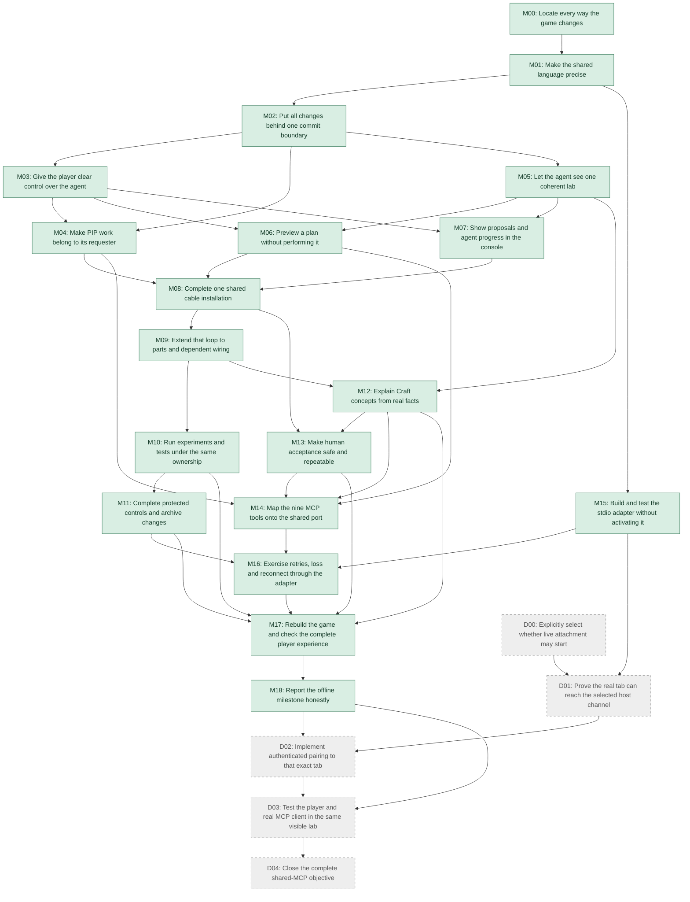

# Shared player–agent MCP: detailed implementation DAG

Date: 2026-10-29. Status: M00–M18 are implemented and locally checked; the consolidated final report is [VALIDATION.json](/home/vlad_/projects/cyberAlchemy-v2/goals/plans/craft-game-shared-mcp-2026-10-29/VALIDATION.json). D00–D04 remain deferred. Both complete mission paths pass on the same frozen build. Design: [DESIGN.md](DESIGN.md). Shared contracts: [CONTRACTS.md](CONTRACTS.md). Two-round critique: [distill/RECONCILIATION.md](/home/vlad_/projects/cyberAlchemy-v2/goals/plans/craft-game-shared-mcp-2026-10-29/distill/RECONCILIATION.md). Machine graph: [DAG.json](DAG.json). Open questions are owned by the design.

The order deliberately builds capabilities on each other: **one cable → parts with dependent wiring → experiments → protected controls/archives → complete guided experience → MCP adapter integration**. Kernel and contract work establish those cumulative steps. One current implementation is repaired throughout; focused tests are development checks, not repeated governance gates. Only the final consolidated functional report carries the completed-scope claim.

M00–M18 can be developed and checked without a listener. D00–D04 are explicitly deferred; they are mandatory for eventual live same-tab completion but do not block the offline milestone. No instruction here starts a host/server, registers MCP, pairs the user tab or publishes anything. Source paths below use `lab/` and `game-mcp/` under `release-candidates/craft-alchlang-current/public-source-repository/examples/engineering-game/`. Paths identify current implementation boundaries; exact source and check references are recorded in [VALIDATION.json](/home/vlad_/projects/cyberAlchemy-v2/goals/plans/craft-game-shared-mcp-2026-10-29/VALIDATION.json).

## Complete dependency graph

## Parallel work with subagents

Use at most **three workers plus the integrator**, matching four available slots. The schedule below records the dependency and ownership strategy used for cumulative implementation. Policy/UI, observations and SDK work used separate worker agents while the integrator composed preview, ownership and PIP effects. The two Distill reviewers completed the design critique before implementation.

| Frontier | Integrator | Worker A | Worker B | Worker C |
|---|---|---|---|---|
| M00–M01 | Mutation inventory and shared-contract integration | Optional bounded schema/value extraction, no app edits | Optional fixture extraction | Optional protocol source research |
| After M01 | M02 commit boundary / app.js | M15 inactive stdio package against contract fixtures | Prepare M05 pure projection fixtures | Prepare M07 console fixtures |
| After M02 | M03 policy integration | M05 observations | M15 protocol/lock | UI fixture work; no runtime activation |
| After M03/M05 | Integrate app and shared hooks | M04 PIP/ledger, owns tasks.js | M06 preview module | M07 console UI |
| First join | M08 one real cable loop | Fix PIP integration issues | Fix preview/read issues | Fix UI integration issues |
| After M08/M09 | M10 production then M11 protected actions | M09 task mechanics under assigned file ownership | M12 provenance/guide reads | M13 proposal UI after M12; M15 if unfinished |
| Adapter join | Integrate completed action registry | M14 handlers after its prerequisites | M16 fault checks after M14/M15/M11 | Existing UX regressions / documentation |
| Final offline | M17 build and full regression, then M18 report | Repair assigned task defects | Repair assigned read/preview defects | Repair assigned UI/protocol defects |

Prerequisites in DAG.json override approximate frontier labels. Preparation with fixtures is not completion of a task whose dependencies are missing. `app.js`, `commands.js`, shared registry/schema and build wiring each have one integrator; `tasks.js` has one PIP owner. Workers propose shared-file changes for that owner to merge. Pure modules/UI/package paths are independent. Do not use worktrees/candidate copies as an unnecessary intermediate process.

## Detailed tasks and acceptance

### M00 — Locate every way the game changes

**Completed 2026-10-29:** 62 mutation families and 12 read classifications in the source-linked mutation map; runtime source unchanged.

**Needs:** none. **Lane:** offline. **Owner:** Integrator.

Make a bounded mutation map for the current game: direct UI, PIP stages, fixtures, guide actions, undo, save selection, simulation ticks and worker replies. Reuse current generated models and existing gameplay checks; do not re-audit all Craft C01–C15 or create a fresh candidate.

**Done when:** A table names each mutator, its future command handler, effects, caller and existing check. Identify actual generated/host decision boundaries and build inclusion points.

**Files/surfaces:** `lab/app.js`; `lab/tasks.js`; `lab/tools.js`; `lab/world.js`; `lab/scene3d.js`; `lab/guide.js`; `lab/build.mjs`.

**Focused checks:**

- No mutating public getter is classified as a safe read.
- The hidden notebook/read-command effects and worker commits appear explicitly.

### M01 — Make the shared language precise

**Completed 2026-10-29:** immutable registry, closed per-tool/domain schemas, typed BrowserPort, generated artifacts, semantic validators and fixtures. 172 contract tests, 86 independent JSON Schema checks, TypeScript checks and the existing 21 business-model checks passed. See [VALIDATION.json](/home/vlad_/projects/cyberAlchemy-v2/goals/plans/craft-game-shared-mcp-2026-10-29/VALIDATION.json).

**Needs:** M00. **Lane:** offline. **Owner:** Integrator/contracts owner.

Emit the closed BrowserPort requests/results, nine per-tool success DTOs, errors, action registry, eleven action variants, ownership/custody references, lifecycle transitions and byte/count bounds. Extract business DTO fields from actual compiled/profile values. Bundle local schema definitions per emitted tool; generate both UI and adapter contracts from the registry.

**Done when:** Executable positive/negative fixtures freeze what each module receives and returns. Data/error/subject unions and bootstrap are closed. Receipt upper bounds fit the reserved compact-record budget without whole-world copies. Only then give independent workers those contracts.

**Files/surfaces:** `lab/contracts/* (new)`; `lab/action-registry.js (new)`; `API.json design seed`; `CONTRACTS.md obligations`.

**Focused checks:**

- Reject malformed inspect selectors, contradictory results, duplicate actionKey, forward/incorrect output reference and oversized bodies.
- Validate every local schema ref; assert 9 tools/11 variants, conditional safe-control scopes and snapshot-only optional target.

### M02 — Put all changes behind one commit boundary

**Completed 2026-10-29:** shared synchronous service, wrapped current UI/PIP/guide effects, immutable captures/readers, version/handle/async guards, forked save continuity and built delivery. The historical M02 milestone passed 222 Node tests and 80 browser assertions. The consolidated report records the larger current offline test scope, including both full missions on the final build. See [VALIDATION.json](/home/vlad_/projects/cyberAlchemy-v2/goals/plans/craft-game-shared-mcp-2026-10-29/VALIDATION.json) and [implementation notes](/home/vlad_/projects/cyberAlchemy-v2/release-candidates/craft-alchlang-current/public-source-repository/examples/engineering-game/lab/contracts/M02.md).

**Needs:** M01. **Lane:** offline. **Owner:** Integrator; sole app.js owner.

Extract immutable capture and pure model/geometry inputs; make all UI/PIP/fixture/guide/undo/worker changes use the command service. Introduce world/graph/queue/control versions, event watermark and epoch/incarnation allocators outside undo. Select an isolated shared-session save branch before its first save; preserve original save and keep branch after disconnect. Inject new modules into the existing offline build in order.

**Done when:** Existing player actions run through wrappers with the same business semantics. A command commits once and advances only relevant versions; reads cannot mutate world/queue/custody. No direct state escape remains.

**Files/surfaces:** `lab/commands.js (new)`; `lab/app.js`; `lab/worker commit wiring`; `lab/build.mjs`; `lab/template.html`.

**Focused checks:**

- Read/inspect/model evaluation does not change game state or authoritative versions.
- Undo/recreation invalidates old part/wire handles; worker cause mismatches cannot commit.
- All shared-tab save routes use the branch; original save unchanged and quota warning remains visible.

### M03 — Give the player clear control over the agent

**Completed 2026-10-29:** offline implementation and functional checks are linked in [VALIDATION.json](/home/vlad_/projects/cyberAlchemy-v2/goals/plans/craft-game-shared-mcp-2026-10-29/VALIDATION.json). The deferred live lane is excluded.

**Needs:** M02. **Lane:** offline. **Owner:** Policy worker; integrator wires app hooks.

Implement one authenticated actor, Observe/Suggest/Assist scopes, monotonic lease, grant/control generation, immediate local Stop and takeover before human edits. Distinguish passive modal/visibility pause from takeover. Reject a second attachment. Define custody cleanup and simulation ownership revocation hooks.

**Done when:** Camera/search/selection remain independent. Human world/task instructions revoke assisted writing before their effect. A frozen or disconnected tab cannot resume old work without checking current lease/grant.

**Files/surfaces:** `lab/control.js (new)`; `lab/commands.js integration by integrator`.

**Focused checks:**

- Late stage after takeover is denied.
- Lease expiry and invalid credentials fail closed; human offline controls still work.
- Closing notebook does not revive a revoked grant.

### M04 — Make PIP work belong to its requester

**Completed 2026-10-29:** offline implementation and functional checks are linked in [VALIDATION.json](/home/vlad_/projects/cyberAlchemy-v2/goals/plans/craft-game-shared-mcp-2026-10-29/VALIDATION.json). The deferred live lane is excluded.

**Needs:** M02, M03. **Lane:** offline. **Owner:** PIP worker; sole tasks.js owner.

Add actor/origin/operation/action/stage metadata, typed outputs and custody, retained request index and bounded events. Implement idle-only all-or-none admission and selective controls. Each logical action equals one staged job. Controls use operation-local high-water sequences; external receipt capacity never blocks ordinary human play.

**Done when:** Accepted/running/blocked/completed/cancelled/failed, real committed effects and remaining work are separately queryable. Duplicate accepted requests recover before stale-preview checks. Pause/cancel owns only its resources and needs no new receipt row; resume checks current grant.

**Files/surfaces:** `lab/tasks.js`; `lab/operations.js (new)`; `lab/events.js (new)`.

**Focused checks:**

- Lose reply then retry same ID/body: one operation, one effect; changed body conflicts.
- At 1,024 records/byte cap, external admission refuses while manual jobs/Stop/own pause-cancel work.
- Lower control sequence is superseded; equal digest replays; altered equal sequence conflicts.
- No-await admission either reserves all <=12 jobs or adds none.

### M05 — Let the agent see one coherent lab

**Completed 2026-10-29:** offline implementation and functional checks are linked in [VALIDATION.json](/home/vlad_/projects/cyberAlchemy-v2/goals/plans/craft-game-shared-mcp-2026-10-29/VALIDATION.json). The deferred live lane is excluded.

**Needs:** M02. **Lane:** offline. **Owner:** Observation worker.

Implement snapshot bootstrap, immutable facets, inspect/options, captured model findings and bounded resources. Capture revisions and event high-water in one turn. Use pure compiled evaluation on a clone; report capture age and explicit stale/unavailable knowledge. Consume scheduler DTOs from M01; integrate actual M04 queue at M08.

**Done when:** A reader can identify exact parts, ports, sites, model meaning, guide state, PIP work and real blockers without opening notes, changing guide flags or camera. No declaration/path outside the allowlist is accessible.

**Files/surfaces:** `lab/observations.js (new)`; `lab/resource-projections.js (new)`.

**Focused checks:**

- Snapshot during production is internally consistent.
- Unavailable does not invent zero versions or a target.
- Cursor resync cannot miss events after the snapshot watermark; response bytes bound pagination.

### M06 — Preview a plan without performing it

**Completed 2026-10-29:** offline implementation and functional checks are linked in [VALIDATION.json](/home/vlad_/projects/cyberAlchemy-v2/goals/plans/craft-game-shared-mcp-2026-10-29/VALIDATION.json). The deferred live lane is excluded.

**Needs:** M03, M05. **Lane:** offline. **Owner:** Preview worker.

Normalize actions and interpret their own intermediate state using shared pure reducers. Bind exact target/build/actor/control generation, monotonic expiry, relevant read set and effects. Block busy PIP, foreign custody, running topology edits and unknown prerequisites. Add bounded derived cache and contract checks for all-or-none commit.

**Done when:** Preview explains exact targets, typed outputs, side effects and blockers. It cannot take a part, touch a port, start PIP, change lesson flags or alter authoritative revisions. No queue-prefix planner is required.

**Files/surfaces:** `lab/preview.js (new)`; `lab/action-registry.js handlers via single owner`.

**Focused checks:**

- Flood preview cache stays at 16/1 MiB and old tokens expire.
- Stale resource or actor/epoch cannot execute; irrelevant frame/read does not invalidate.
- Predicted reset/approval/custody effects are disclosed and match commit.

### M07 — Show proposals and agent progress in the console

**Completed 2026-10-29:** offline implementation and functional checks are linked in [VALIDATION.json](/home/vlad_/projects/cyberAlchemy-v2/goals/plans/craft-game-shared-mcp-2026-10-29/VALIDATION.json). The deferred live lane is excluded.

**Needs:** M03, M05. **Lane:** offline. **Owner:** UI worker.

Build disconnected/Observe/Suggest/Assist states, attributed draft/progress/result views, visible Stop/Take over and concise blocker explanations. Consume DTO fixtures while scheduler/preview are built. Render agent/model text literally, support keyboard/focus and preserve Full lab/Follow PIP and existing mission UI.

**Done when:** One existing console can explain what is requested, what has actually happened and who controls PIP. No working Connect badge implies an activated bridge. Busy/stale/offline conditions are understandable.

**Files/surfaces:** `lab/agent-console.js (new)`; `lab/style.css`; `lab/template.html; integrator merges shared edits`.

**Focused checks:**

- Markup in reasons is literal text.
- Controls are keyboard accessible and do not steal camera or lesson Continue.
- Accepted is visibly distinct from completed and domain goal achieved.

### M08 — Complete one shared cable installation

**Completed 2026-10-29:** offline implementation and functional checks are linked in [VALIDATION.json](/home/vlad_/projects/cyberAlchemy-v2/goals/plans/craft-game-shared-mcp-2026-10-29/VALIDATION.json). The deferred live lane is excluded.

**Needs:** M04, M06, M07. **Lane:** offline. **Owner:** Integrator; first cumulative vertical slice.

Join the real kernel, PIP scheduler, preview and console through the in-memory BrowserPort. Start with two existing compatible endpoints; observe, preview, admit, animate PIP, commit cable and read the real generated report. Exercise a player interruption between stage start and effect.

**Done when:** A visible real cable is installed once, or a typed interruption reports the actual committed state. No network listener, host registration or cloned world is used. This is the first meaningful functional milestone, not a standalone governance gate.

**Files/surfaces:** `lab/commands.js`; `lab/tasks.js`; `lab/agent-console.js`; `new focused shared-control checks`.

**Focused checks:**

- Compatible cable success; occupied/wrong-type port rejection.
- Duplicate/lost reply; takeover prevents deliberately late cable commit.
- Player manual controls/camera/guide remain usable.

### M09 — Extend that loop to parts and dependent wiring

**Completed 2026-10-29:** offline implementation and functional checks are linked in [VALIDATION.json](/home/vlad_/projects/cyberAlchemy-v2/goals/plans/craft-game-shared-mcp-2026-10-29/VALIDATION.json). The deferred live lane is excluded.

**Needs:** M08. **Lane:** offline. **Owner:** PIP worker; integrator owns app changes.

Add collect, explicit place, assemble, return_carried, move, rotate, installed return, set_speed and wire disconnect. Support backward-only typed createdBy outputs and explicit prior owned carry transfer. Keep installed identity during moves and invalidate recreated part/wire incarnations. Declare attached-wire removal and production resets.

**Done when:** A plan can install a filter and connect its newly created ports. Interruptions release only owned loose resources and preserve already committed parts; no implicit consumption of a human-held item.

**Files/surfaces:** `lab/tasks.js`; `lab/commands.js bindings`; `lab/preview.js`; `lab/action-registry.js`.

**Focused checks:**

- Install→connect output resolution; collect→place and return_carried.
- Cancel during collection/move/cable stage; safe restoration of lifted existing part.
- Old wire handle cannot disconnect a recreated cable with identical endpoints.

### M10 — Run experiments and tests under the same ownership

**Completed 2026-10-29:** offline implementation and functional checks are linked in [VALIDATION.json](/home/vlad_/projects/cyberAlchemy-v2/goals/plans/craft-game-shared-mcp-2026-10-29/VALIDATION.json). The deferred live lane is excluded.

**Needs:** M09. **Lane:** offline. **Owner:** Integrator; simulation/worker owner.

Implement desired run/pause/schedule controls, standalone bounded run and reset, step, and interlock test using actual generated operations. Retain ownership of production/worker commits until actual complete/bound/blocked/stop. Keep report predicate truth distinct from operation completion.

**Done when:** Agent-caused production cannot continue ownerless after its receipt completes or its grant is revoked. A test can complete with a false domain result and explain missing conditions. No formal solver or speed guarantee is introduced.

**Files/surfaces:** `lab/app.js run/tick/worker`; `lab/tasks.js equipment stages`; `lab/commands.js desired-state handlers`.

**Focused checks:**

- Pause/revoke then deliver late worker reply: no commit.
- Run reaches actual goal or bounded blocked result; no empty-queue success inference.
- Repeated desired-state controls do not toggle away; interlock counterexample remains truthful.

### M11 — Complete protected controls and archive changes

**Completed 2026-10-29:** offline implementation and functional checks are linked in [VALIDATION.json](/home/vlad_/projects/cyberAlchemy-v2/goals/plans/craft-game-shared-mcp-2026-10-29/VALIDATION.json). The deferred live lane is excluded.

**Needs:** M10. **Lane:** offline. **Owner:** Integrator/domain action owner.

Add effectful read_board/read_record, badge desired state, approve/send/receive, archive store/restore and next mission through the same registry. Preserve ApplyCommand authorization/eligibility and C-23 replay behavior independently of transport IDs. Exact restore archive revision/digest and mission target are frozen in preview; global replacements are standalone.

**Done when:** All exposed game control actions use the shared path. Restoring/resetting never rewinds operation/control history or binds old numeric IDs to new objects. Denied/not-ready results and real guide effects are visible.

**Files/surfaces:** `lab/commands.js equipment bindings`; `lab/app.js wrappers`; `lab/action-registry.js`.

**Focused checks:**

- No Assist scope bypasses missing badge/business prerequisites.
- Archive changes after preview cannot substitute another restore target.
- Branch save after human and agent actions/disconnect preserves original; storage failure stays visible.

### M12 — Explain Craft concepts from real facts

**Completed 2026-10-29:** offline implementation and functional checks are linked in [VALIDATION.json](/home/vlad_/projects/cyberAlchemy-v2/goals/plans/craft-game-shared-mcp-2026-10-29/VALIDATION.json). The deferred live lane is excluded.

**Needs:** M05, M09. **Lane:** offline. **Owner:** Observation/documentation worker.

Link parts/actions/findings to real generated declarations, selected profile and model/graph/bridge views. Keep source facts, host realizations and agent prose distinct. Distinguish pure semantic inspect from in-world read operations and preserve human-only guide acknowledgment. Document the difference between simulated records/interfaces and real DB/API/IdP implementations.

**Done when:** Agent can explain why a component is needed and which Craft/AlchLang element it teaches without claiming a nonexistent transport profile or formal verification.

**Files/surfaces:** `lab/resource-projections.js`; `lab/guide.js read projections`; `lab/notebook-data.js references`.

**Focused checks:**

- Forged source/fact IDs cannot become trusted evidence or permissions.
- Guide predicates are actual compiled/host observations, not receipt status.
- Pure reads do not advance lessons; Continue remains player-only.

### M13 — Make human acceptance safe and repeatable

**Completed 2026-10-29:** offline implementation and functional checks are linked in [VALIDATION.json](/home/vlad_/projects/cyberAlchemy-v2/goals/plans/craft-game-shared-mcp-2026-10-29/VALIDATION.json). The deferred live lane is excluded.

**Needs:** M08, M12. **Lane:** offline. **Owner:** UI worker; integrator connects trusted human dispatch.

Finish Suggest drafts: edit/reject/accept with provenance, bounded tray and expiry. Accept re-previews current actions and creates a human-sponsored operation keyed by proposal/revision, never grants Assist. Display partial effects and remaining work. Keep ordinary player controls working even at external receipt capacity.

**Done when:** A Suggest-only actor cannot execute; human acceptance either admits once under fresh human authority or shows a specific busy/stale/capacity blocker. No per-action dialog is added after an explicit scope grant.

**Files/surfaces:** `lab/agent-console.js`; `lab/commands.js proposal acceptance`; `lab/template.html`; `lab/style.css`.

**Focused checks:**

- Edited/expired proposal revalidates; repeated acceptance does not duplicate.
- Proposal flood bounded at 8/512 KiB; accepted identities survive tray removal.
- Human input/Stop still works with receipt store full.

### M14 — Map the nine MCP tools onto the shared port

**Completed 2026-10-29:** offline implementation and functional checks are linked in [VALIDATION.json](/home/vlad_/projects/cyberAlchemy-v2/goals/plans/craft-game-shared-mcp-2026-10-29/VALIDATION.json). The deferred live lane is excluded.

**Needs:** M04, M06, M12, M13. **Lane:** offline. **Owner:** Adapter worker.

Implement tool and resource handlers using emitted schemas and BrowserPort, not direct Workshop globals. Apply authenticated target binding, per-tool scopes and conditional safety-control rules. Provide bounded errors/results and stale cache behavior; no arbitrary eval/file access, lesson/camera mutation or scope escalation.

**Done when:** All nine application tools exercise the same service using an in-memory test port. API success DTOs are closed; SDK framing is separate. No second simulation is substituted for the real attached world.

**Files/surfaces:** `examples/engineering-game/game-mcp/src/tools/* (new)`; `lab/agent-port.js (new)`.

**Focused checks:**

- Malformed selectors/scope spoofing/foreign operation controls fail.
- Timeout recovered by actor-scoped request lookup; unavailable rejects effects.
- Tool annotations do not grant authority.

### M15 — Build and test the stdio adapter without activating it

**Completed 2026-10-29:** offline implementation and functional checks are linked in [VALIDATION.json](/home/vlad_/projects/cyberAlchemy-v2/goals/plans/craft-game-shared-mcp-2026-10-29/VALIDATION.json). The deferred live lane is excluded.

**Needs:** M01. **Lane:** offline. **Owner:** Protocol/package worker.

Resolve candidate SDK imports, engine compatibility and exact transitive integrity lock. Test modern MCP metadata/discovery/tools/resources using official SDK reference clients over stdio pipes and a fixture BrowserPort. Add legacy only if explicitly selected/tested. Keep registration/startup instructions as future instructions, not effects in this task.

**Done when:** Deterministic bounded stdio requests/replies work against the reference client and in-memory port. Stdout has protocol messages only. No listener, game-page server, host configuration change, live pairing or actual-host support claim.

**Files/surfaces:** `examples/engineering-game/game-mcp/package.json (new)`; `game-mcp/package-lock.json (new)`; `game-mcp/src/server.* (new)`; `game-mcp/test/* (new)`.

**Focused checks:**

- Unsupported protocol/malformed/oversized messages fail predictably.
- Closed input/output schema emission works in SDK; extension list excludes MCP Tasks.
- Reference-client tuple and measured runtime identified; actual Windows host still unqualified.

### M16 — Exercise retries, loss and reconnect through the adapter

**Completed 2026-10-29:** offline implementation and functional checks are linked in [VALIDATION.json](/home/vlad_/projects/cyberAlchemy-v2/goals/plans/craft-game-shared-mcp-2026-10-29/VALIDATION.json). The deferred live lane is excluded.

**Needs:** M11, M14, M15. **Lane:** offline. **Owner:** Adapter/test worker.

Inject lost replies, duplicate/out-of-order packets, stale epochs, expired previews/events, grant loss, lease expiry, byte/capacity saturation and reconnect using the same port and real kernel in a test harness. Assemble actual tool handlers with the stdio implementation; snapshots/events rejoin from watermark.

**Done when:** MCP application semantics and offline command behavior agree under faults. A test harness reports its transport honestly; it cannot qualify the actual selected tab or host.

**Files/surfaces:** `game-mcp/test/shared-control-faults.* (new)`; `lab/shared-control test harness`.

**Focused checks:**

- Same accepted request cannot reexecute; old epoch never replayed.
- Event overflow resync preserves receipt outcomes.
- Safe controls and local human input survive saturated admission.

### M17 — Rebuild the game and check the complete player experience

**Completed 2026-10-29:** offline implementation and functional checks are linked in [VALIDATION.json](/home/vlad_/projects/cyberAlchemy-v2/goals/plans/craft-game-shared-mcp-2026-10-29/VALIDATION.json). The deferred live lane is excluded.

**Needs:** M10, M11, M12, M13, M16. **Lane:** offline. **Owner:** Integrator/QA; no shared source editing during final checks.

Build the single offline HTML with new modules in correct order. Run every exposed action and all 25 guided lessons, ordinary manual and PIP controls, assembly feedback, camera modes, responsive sizes, no-WebGL fallback and offline play. Use an owned QA file tab without a server; preserve the user tab. Check late worker/stage races and resource bound cases on actual built output.

**Done when:** The complete offline game works with and without the test agent driver. Measurements report time/memory/environment without a speed promise. Fix the same cumulative source and rerun affected checks; no new candidate snapshots or intermediate proof ceremony.

**Files/surfaces:** `lab/build.mjs`; `lab/index.html + manifest (generated)`; `owned file-open QA browser`; `existing relevant gameplay checks`.

**Focused checks:**

- All 25 guide predicates still work, acknowledgment human-only.
- Full lab/Follow PIP, keyboard/touch controls and renderer fallback preserved.
- Generated/source/profile/build identities match the assembled HTML.

### M18 — Report the offline milestone honestly

**Completed 2026-10-29:** offline implementation and functional checks are linked in [VALIDATION.json](/home/vlad_/projects/cyberAlchemy-v2/goals/plans/craft-game-shared-mcp-2026-10-29/VALIDATION.json). The deferred live lane is excluded.

**Needs:** M17. **Lane:** offline. **Owner:** Integrator.

Summarize actual changes, functional results, observed performance and remaining limitations in one report for this working implementation. Record exactly which sources/build/client tuple were tested; keep actual-tab acceptance explicitly not run. Document branch saves, modes, partial results, stop/retry and bounded live-epoch guarantees.

**Done when:** Offline shared-control scope has one consolidated functional record. The whole live-MCP objective remains pending D01–D04. No publication or activation is implied; later live acceptance extends this same report rather than creating candidate/proof chains.

**Files/surfaces:** `one consolidated implementation completion report`; `game-mcp local setup/support docs`; `game action/contract documentation`.

**Focused checks:**

- No current gameplay or reference-client check is labelled actual-tab MCP proof.
- Setup docs distinguish not-started bridge from verified offline behavior.

### D00 — Explicitly select whether live attachment may start

**Needs:** none. **Lane:** deferred-live. **Owner:** Owner decision, deferred; not a current question.

Lift only the needed local control-channel/host-registration deferrals if and when desired. Identify permitted channel, browser/host, platform and effects. Do not infer permission from the current design/DAG request.

**Done when:** A specific future scope permits the relevant live effects, or this entire lane remains deferred.

**Files/surfaces:** `Operational scope decision only`.

**Focused checks:**

- No listener/registration/pairing begins while this node is deferred.

### D01 — Prove the real tab can reach the selected host channel

**Needs:** D00, M15. **Lane:** deferred-live. **Owner:** Transport investigator.

Prove a nonce round trip from the actual selected Windows in-app file tab, without remote debugging or invisible clone. Determine embedded browser restrictions, supported host protocol and exact engine/SDK tuple. Prefer Windows; evaluate WSL only with demonstrated forwarding/identity. A failed probe leaves live integration blocked, not falsely replaced with a test browser.

**Done when:** Supported actual-tab channel and intended-host tuple are established, or a concrete unsupported limitation is reported.

**Files/surfaces:** `isolated harmless nonce probe`; `exact Windows/optional WSL + host/protocol compatibility tuple`.

**Focused checks:**

- No unrelated tab scanned/controlled; no assets or game pages hosted.
- Protocol compatibility is actual-host evidence, separate from M15.

### D02 — Implement authenticated pairing to that exact tab

**Needs:** D01, M18. **Lane:** deferred-live. **Owner:** Transport worker; integrator owns game bridge wiring.

Carry BrowserPort across the qualified channel. Pair user-initiated with one-use secret, exact target/build, loopback-only endpoint if selected, Host/Origin checks and secret redaction. Enforce single attachment, credentials/scopes, heartbeat/lease/disconnect, backpressure and message bounds. No fallback to arbitrary browser automation.

**Done when:** The companion forwards to one actual authoritative tab. Wrong/expired token, opaque origin without secret, second attachment and old epoch cannot act.

**Files/surfaces:** `lab/agent-bridge.js (new)`; `game-mcp browser channel/launcher modules (new)`; `exact channel configuration`.

**Focused checks:**

- Pair/revoke/reconnect and WSL/Windows path behavior on selected platform.
- Secrets absent from tools, logs, URLs and exports; channel close pauses owned effects.

### D03 — Test the player and real MCP client in the same visible lab

**Needs:** D02, M18. **Lane:** deferred-live. **Owner:** Integrator/actual-host QA.

Run an actual observe→suggest/accept→assist→PIP effect→outcome loop in the same visible game. Exercise takeover, disconnect/reload, lost reply, old/second tab, denied scope and late worker result. Verify supported transport-neutral DTO behavior against the qualified host and preserve guided mission/camera controls.

**Done when:** A real agent and player demonstrably share one tab/world. Any missing actual-host coverage remains a stated limit rather than being filled by mock tests.

**Files/surfaces:** `actual selected file-open tab`; `real MCP client`; `built game from M17`.

**Focused checks:**

- Human sees exact operation/cable/result agent observed.
- No hidden duplicate world, missed takeover or cross-tab save overwrite.

### D04 — Close the complete shared-MCP objective

**Needs:** D03. **Lane:** deferred-live. **Owner:** Integrator.

Add actual-tab/host findings, final limits and delivery instructions to the same consolidated report. Reconcile supported tuples and final build/contract identities. Leave TDE, EVF, publication, remote sessions and other follow-on capabilities deferred.

**Done when:** Only now may the report claim tested shared player–agent MCP control for the exact qualified tuple. Publication remains a separate unrequested action.

**Files/surfaces:** `extend the same consolidated completion report from M18`.

**Focused checks:**

- All completion claims point to tests at the right boundary.

## Acceptance claims and remaining questions

- M08 establishes the smallest meaningful shared cable loop through the actual game command layer; it is not live MCP integration.
- M18 establishes the complete offline command/UI/adapter behavior against stated fixtures/reference clients; actual host and channel remain unproved.
- D04 can close real shared-MCP control only after D01–D03 actual-tab evidence and lifted operational deferral. Extend the same final report; do not create a new series of sealed candidates.
- Existing Craft C01–C15 results remain reusable context. No generic compiler, transport profile, database, identity service or formal-engine implementation is a hidden prerequisite of this game task.
- Open questions: [DESIGN.md](DESIGN.md#completion-and-open-questions). No product decision blocks the bounded offline task order. Exact DTO extraction is M01 work; actual embedded-browser channel, Windows/WSL placement and host tuple are deferred empirical work. No date/speed promise is inferred from this graph.
