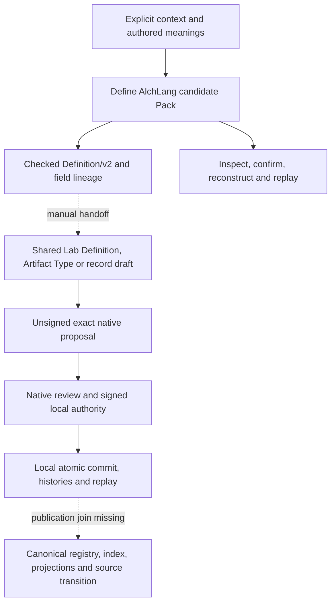

# Definitions and records workflow audit

Date: 2026-11-09. Base commit: 5fd26080986e099923977e2f5d8a70815b269eb5. Scope: current Define AlchLang, the shared Lab creation/admission runtime, canonical definitions, records, construction contracts, and retained evidence. This audit changes no implementation, admitted meaning, registry, permission or native operator store.

## Conclusion

The Python-to-AlchLang migration is complete for the current local candidate Define CLI. The broader definitions and records workflow is not yet a single complete, governed workflow. Native record creation, type registration, authorization, commit, replay and recovery already exist as shared components; the main missing work is their scope-correct orchestration, full-chain gate, applicable semantic-owner disposition and canonical publication transition.

The distinction matters: materializing a candidate Definition, recording a confirmation, signing a local fixture transaction, committing a native local branch, pushing Git and admitting a canonical Definition are different events. None can substitute for the required other steps.

## Live baseline

- Canonical registry: 189 admitted Definition versions and 183 selected current identities. Every original digest, current lookup, index path, colocated DEFINITION.md and Definition/v1 schema check passed.
- Shared current source catalog: 444 current subjects, including 183 Definitions and 121 Artifact Types. Its freshness check covered 806 bound files with no changed inputs. These are counts for that exact selected source cut, not a count of every historical file.
- Workspaces: seven Product profiles, one existing shared runtime target, zero runtime copies. The current workspace catalog has no selected native_store_bindings. Source inspection works without reading the operator's default private store.
- Define migration integrity: the current audit rechecked the retained 341 checks across 25 surfaces, all 44 selected semantic bindings, and the retired engine/version absence. Those 341 checks are retained proof revalidated for integrity; they were not all rerun in this audit.
- A fresh actual Define CLI test passed native example, import, exact request export, preparation, inspection, observed confirmation, materialization, member-byte reconstruction and fresh-process session replay.
- Separate new probes confirmed that Product placement is not a supported Define DefinitionScope, and a Product-owned authority write without a real selected Project refuses before reading a proposal.

The fresh shared Lab AlchLang qualification passed all 84 checks, including Definition/record draft creation, Artifact Type registration, signed local admission, fresh-process replay, Event delivery and interruption recovery. See TEST-RESULTS.json for exact commands and source-bound fixture scope. Component fixture results do not establish production grants, shared runtime activation or complete canonical publication.

## Implemented flow and the joins still missing

A Definition supplies meaning. A record uses an explicitly selected current Artifact Type and schema. Existing carriers should be reused; defining a concept does not automatically register a new carrier, and registering a carrier does not create an instance.

## Complete 16-stage matrix

Statuses distinguish an implemented component from a joined end-to-end journey. Source anchors and exact digests are in SOURCE-EVIDENCE.json; machine-readable coverage is in COVERAGE.json.

| ID | Stage | Current status | Implemented | Remaining |
|---|---|---|---|---|
| CC-01 | Workspace and intent | partial | Product/Project workspace resolution and one shared runtime are implemented. Product-wide source reads work. Define Session/Context and draft creation still require a Project; placement only accepts Work, Project or Imported. | Product-only Define preparation; selected real Project/store onboarding for effects. |
| CC-02 | Discover meanings and carriers | available-separate | 189 admitted Definition versions, 183 current identities and current native catalog resolution are usable. The current source catalog includes 121 Artifact Types. | Bind explicit catalog selections into a common Define request without losing source standing. |
| CC-03 | Capture bounded source evidence | implemented-Define | Current AlchLang selects capture paths, bounds, standing and retention; shared generic adapters retain original bytes and exact bindings. | Join capture to selected workspace/catalog context in the broader coordinator. |
| CC-04 | Record meaning dispositions and contracts | implemented-Define | Question/response sessions and reuse/specialize/propose/open dispositions, applications, parameters, provenance, gaps and readiness are native AlchLang. | Automatic discovery and semantic-owner handoff are outside this local candidate subflow. |
| CC-05 | Materialize Definition/v2 | implemented-Define | Actual complete authored Definition/v2 bodies, human projection and field lineage are preserved and checked. The real User Journey materializes unchanged. | Actual owner acceptance, canonical publication and higher-level successor drafting remain separate. |
| CC-06 | Draft new Definitions | available-separate | Lab.CreateDefinition and a draft-only native CLI validate and preserve the exact authored candidate and unsigned proposal. | Normal create.py calls the Python shared native helper, not the compiled AlchLang operation; no joined Define command. |
| CC-07 | Draft and register Artifact Types | available-separate | Lab.CreateArtifactType, schema/contract binding and native local type registration are implemented and covered by fixture qualification. | Connect the selected carrier/schema/semantic references to Define and a real workspace authority adapter. |
| CC-08 | Draft artifact records | available-separate | Lab.CreateRecord checks explicit current carrier, identity, scope and exact bytes; generated consequences and specialized types cannot masquerade as generic authored records. | Route through the actual AlchLang operation in the common workflow and add selected workspace/Work custody. |
| CC-09 | Semantic review | partial-governance | Review packets, independent agent semantic assessment and approve/reject/revise/defer contracts exist. Structural review is separately implemented. | Applicable semantic-owner outcome for five candidates and contract selection remains absent; schema validity is insufficient. |
| CC-10 | Authorize exact effects | implemented-native-separate | Existing native review, Ed25519 approval and effect/source/HEAD checks are implemented. Generated AlchLang policies preserve readiness versus authority. | Selected workspace/store binding and an authenticated non-fixture operator adapter; no default permissions or stores. |
| CC-11 | Commit once and replay | implemented-native-separate | Original native Store.apply writes immutable transactions and atomic HEAD with deterministic histories/consequences and idempotent replay. | Connect the Define package and draft identities to this exact transaction and audit its authoritative result. |
| CC-12 | Reconcile uncertain effects | implemented-separate | Define handles publication uncertainty and journal replay; shared native workflow inspects unknown outcomes and returns proven no-effect to review. | One resumable operator journey across package, draft, review, transaction and publication boundaries. |
| CC-13 | Reconstruct retained material | implemented-portable | Define reconstructs every required frozen package member byte and replays its saved candidate session without the original package. | General committed Work/Source discovery and reconstruction by current workspace identity are not joined. |
| CC-14 | Revise and withdraw | partial | Native operations support admit/revise/withdraw with exact predecessor and dependency checks. Define has explicit request successor revisions. | Shared creation helpers only prepare Admit with no predecessor; no integrated Definition/record lifecycle authoring or transitive design-impact refresh. |
| CC-15 | Canonical publication and source transition | not-joined | Local native commit exists and existing repository governance publication artifacts/builders exist. The canonical Definition registry remains Definition/v1. | Explicit authorized Definition/v2-compatible registry/index/projection/drift/state/source transition; local commit does not perform repository admission. |
| CC-16 | Enforce full construction and generation chain | contract-only-gate | Existing meanings, artifacts, business/bridge/system design projections, six handoff contracts and pinned source generation exist. | Execute the full-chain gate, reject missing/stale handoffs, invalidate dependent results and independently assess generated output against the selected design. Current source compilation does not enforce this gate. |

## Gaps and remediation

### G1: Five existing construction-related candidates still lack canonical admission.

Priority: high. Kind: governance.

Obtain the applicable exact owner disposition and select contract compatibility. An agent audit, local fixture signature or Git commit is not that disposition.

Evidence: `owner-gates.json`. Targets: `cal.definition.lab-workspace@2.0.0-candidate.1`, `cal.definition.definition-pack@1.0.0-candidate.1`, `cal.definition.cyberalchemy-define@1.0.0-candidate.1`, `cal.definition.construction-chain-contract@1.0.0-candidate.1`, `cal.definition.construction-stage-handoff@1.0.0-candidate.1`.

### G2: Full construction-chain gate is specified but not executed by the current Define builder.

Priority: high. Kind: implementation.

Implement the existing gate as a selected source-bound workflow before conformant generation, including handoff freshness, design coverage, capabilities and independent output conformance. Keep the generic compiler generic.

Evidence: `chain-enforcement-inspection.json`. Targets: `authority/definitions/candidates/0018-construction-chain/contracts/generation-gate.json`, `workspaces/products/define/implementation/cli/alchlang/build.mjs`, `workspaces/products/define/implementation/cli/alchlang/runtime/build.mjs`.

### G3: No continuous Define workflow joins portable packages to artifact-type/record drafts, review dispositions, authorization, native commit and canonical publication.

Priority: high. Kind: implementation.

Compose existing capabilities with persistent exact correlation and recovery. CandidatePreparation/ReviewRequest and shared CandidateAdmission exist, but CLI prepare does not run a production review queue or admission coordinator.

Evidence: `SOURCE-EVIDENCE.json`. Targets: `workspaces/products/define/implementation/cli/alchlang/runtime/cli.mjs`, `workspaces/products/define/implementation/cli/alchlang/preparation.alch`, `implementation/lab-runtime/alchlang/lab.alch`, `implementation/lab-runtime/alchlang/create.py`.

### G4: Product Workspace reads work, but Define sessions/drafts have Project-centric scope and no Product placement.

Priority: high. Kind: implementation-and-scope.

Define Product-wide no-Project preparation explicitly and preserve native Project membership for effects that require it; onboard real selected Project/store bindings instead of inventing migration Projects.

Evidence: `boundary-probes.json`. Targets: `workspaces/products/define/implementation/cli/alchlang/modules/work/contracts.alch`, `workspaces/products/define/implementation/cli/alchlang/modules/meanings/contracts.alch`, `implementation/lab-runtime/alchlang/modules/records/contracts.alch`, `implementation/lab-workspaces/v2/catalog.json`.

### G5: Shared draft CLI executes Python native creation logic rather than the compiled creation operations; the generated admission stage remains a qualification fixture adapter.

Priority: high. Kind: implementation-and-qualification.

Route shared draft decisions through the existing AlchLang operations and add a custody/authenticated production host adapter for the existing native writer. Do not recreate the removed Python Define engine or duplicate the Lab runtime.

Evidence: `SOURCE-EVIDENCE.json`. Targets: `implementation/lab-runtime/alchlang/create.py`, `implementation/lab-runtime/alchlang/ports/creation.py`, `implementation/lab-runtime/alchlang/ports/native-fixture.mjs`.

### G6: Definition/v2 candidate materialization is not a canonical registry publication path; registry still declares Definition/v1.

Priority: high. Kind: governance-and-publication.

Select an explicit compatible carrier/registry transition, authorize exact deterministic postimages, publish indexes/projections/drift/state, and move the source cut explicitly. Preserve admitted historical v1 bytes.

Evidence: `registry-inspection.json`. Targets: `authority/definitions/registry.json`, `authority/definitions/candidates/0018-construction-chain/contracts/evolution.json`.

### G7: Integrated Definition/record lifecycle helpers only create new admissions.

Priority: medium. Kind: implementation.

Reuse existing native revision/withdrawal checks and add predecessor-bound authoring, dependent type/record/ontology/consumer impact and explicit store/source transition helpers.

Evidence: `SOURCE-EVIDENCE.json`. Targets: `implementation/lab-runtime/alchlang/modules/transactions/use-cases/prepare-creation.alch`, `implementation/lab-runtime/alchlang/ports/creation.py`, `implementation/lab-runtime/v2/lab_runtime/operations.py`.

### G8: The older full-chain resource projection has five references to removed Python/connector sources; migration completion flags are narrower than workflow completion.

Priority: medium. Kind: mapping-and-evidence.

Create a reviewed successor projection referencing current AlchLang roles and current tests. Preserve original frozen review evidence; separate routing/candidate proof from production write and full-chain conformance claims.

Evidence: `chain-enforcement-inspection.json`. Targets: `authority/definitions/candidates/0018-construction-chain/contracts/language-projection.json`, `workspaces/products/define/work/development/alchlang-only/COVERAGE.json`.

## Exact semantic authority residue

The five existing owner-review targets remain outside the admitted registry:

1. Lab Workspace v2 (`cal.definition.lab-workspace@2.0.0-candidate.1`).
2. Definition Pack (`cal.definition.definition-pack@1.0.0-candidate.1`).
3. CyberAlchemy Define (`cal.definition.cyberalchemy-define@1.0.0-candidate.1`).
4. Construction Chain Contract (`cal.definition.construction-chain-contract@1.0.0-candidate.1`).
5. Construction Stage Handoff (`cal.definition.construction-stage-handoff@1.0.0-candidate.1`).

All five authored files and every contract in the existing owner decision request retain their exact bindings. This is an admission/publication gap, not five missing authored files. The selected registry still declares Definition/v1; portable candidate materialization and the shared local branch support Definition/v2. A compatible canonical transition must be selected explicitly; no blanket migration of admitted historical meanings is justified.

The old construction review's hard-coded migration connector no longer exists. Its source-only host problem is partly resolved by the current workspace runtime; Project/store-bound operations and Product-only Define preparation are not thereby complete. Preserve the original rejected proposal and frozen review, then prepare a truthful successor. Do not edit an old packet until its old hash appears to authorize the new behavior.

## Evidence limits and documentation drift

- The 18 migrated DA rows describe the narrower Define implementation, not completion of the 16 wider CC workflow obligations. In particular, DA-16 uses a fixture review inbox, and DA-17's shared-runtime proof includes read-only native dispatch rather than an actual current-workspace authorized record admission.
- Normal CLI prepare runs the native package pipeline; it does not instantiate the separate generated CandidatePreparation/ReviewRequest service or deliver a production semantic review packet.
- The shared draft create.py executes ports/creation.py and native validation. Compiled CreateDefinition/CreateRecord/CreateArtifactType operations exist and have parity checks, but this convenience CLI does not invoke them. This is shared Lab creation logic, not a remaining Python Define engine.
- The registered native document stage is explicitly named and documented as a fixture adapter. A production adapter needs actual authenticated scope, custody and grant selection; the generic writer should remain shared.
- Five existing-support references in the old language-projection contract point to removed Python/connector paths. Record a reviewed successor mapping to current AlchLang resources; preserve historical review digests.
- Model source/profile integrity is implemented. The broader construction-generation gate, six handoff freshness checks and independent semantic design conformance are not automatically enforced by the current Define builder.

## Recommended dependency order

1. Prepare the current owner/publication decision over the five existing candidates and contract compatibility; retain exact unchanged source where applicable.
2. Create successor source/design mappings for the current AlchLang implementation, preserving old frozen evidence and explicit residue.
3. Select Product versus Project/Work preparation semantics and implement the existing full-chain generation gate before claiming conformant future generation.
4. Compose the existing Define and shared Lab creation/semantic-review/admission capabilities, with actual AlchLang entry execution, a non-fixture host adapter and exact package-to-proposal-to-transaction correlation.
5. Complete authorized canonical publication, source transition, successor/withdrawal helpers and transitive impact handling.
6. Qualify one full current-workspace journey from selected definitions through record publication, plus denial, stale dependency, crash, unknown-outcome and replay cases. Keep fixture, local-branch and canonical outcomes separate.

No implementation or authority mutation was performed by this audit. The next implementation should reuse the functioning native components rather than build another Define engine or runtime copy.

## Definitions Governance Summary

- Definitions updated: none.
- Index synced: not applicable; checked and unchanged.
- Drift found: yes, five obsolete resource references and narrower migration evidence versus wider workflow coverage.
- Undefined critical terms: no missing source among the audited semantic selections and five owner-review targets; five targets retain unadmitted standing.
- Conflicting consumers: canonical Definition/v1 versus new Definition/v2 publication requires an explicit compatibility transition; no automatic admission is inferred.
- Validation: see TEST-RESULTS.json for exact fresh outcomes and retained-proof limits.
- Follow-ups: G1–G8, ordered by their semantic, scope, execution and publication dependencies.
