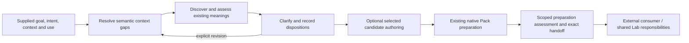

# Define-only semantic preparation design

Integration: the reviewed source selection now lives once in `workspaces/products/define/implementation/cli/alchlang/preparation/sources.json`. The dated design below explains the original review. `workspaces/products/define/implementation/cli/alchlang/preparation/README.md` documents the active CLI, journal protocol, actual observation boundaries and current verification. The original dated compile receipt is historical evidence, not qualification of the integrated CLI.

## Scope and working baseline

Define starts with a supplied bounded goal, originating intent, declared context, named consumer/use and evidence. Its outcome is an exact reviewable Definition Pack, zero or more explicitly selected candidate Definitions, and visible open obligations. It does not discover every relevant concept exhaustively or establish external authority.

Already working: attributable session commands and replay; Ask/Respond; one handling disposition for each declared required concept; exact references and source bindings; parameter/application checks; Pack construction and bounded readiness; observed confirmation; complete authored Definition/v2 materialization and lineage; inspection and byte-exact reconstruction. Ordinary edits already clear stale confirmation. Explicit full-reset successor revisions already exist. These are reused, not redesigned as missing features.

Outside this design: choosing the Product solution or construction method; enforcing the complete construction chain; business/bridge/system ontology construction; general Artifact Type or business-record creation; semantic owner admission; native signing/apply/recovery; canonical publication; implementation generation or consumer conformance. Shared workspace/catalog services remain the source owners. Define only consumes their exact observations and prepares handoff inputs.

## D01 — Context without a compulsory Project/Work

Confirmed integration gap. Current Session.Scope and Context require Project/Work; Product-only preparation is absent. The shared Lab still owns workspace/profile resolution and membership. Define needs a bounded projection of that external selection, not its own workspace engine.

```alchlang
value-object PreparationContext:
  workspace_selection Binding
  context_source Binding
  product optional<Ref>
  project optional<Ref>
  work optional<Ref>
  membership optional<Binding>
  description Binding

rule WorkContextShape:
  input value PreparationContext
  expression absent(value.work) or (present(value.project) and present(value.membership))

operation ValidateContext:
  input value PreparationContext
  output PreparationContext
  on not WorkContextShape(value) reject invalid-context-shape
  return value
```

The operation above is the final shape gate, not complete verification of membership. The source-selection boundary must bind and validate the actual selected workspace projection and exact membership observation. A caller-supplied path or ref is not proof. Product preparation can retain absent canonical Product, Project and Work refs when the workspace selection preserves its navigation-only subject; no fake Project or promoted Product key is added. A source-dependent semantic question may retain an explicit context gap instead of claiming sufficient context.

Goal text remains the bounded desired outcome, not an automatically created Goal business record. A selected real Goal must preserve its externally verified membership when present. Evolve existing Session/context contracts and explicit wire mappings; new model epochs do not silently rebase old journals or old Project/Work-bound packs.

Proposed public intent: `start --context CONTEXT --goal GOAL --intent INTENT --consumer CONSUMER --use USE`; storage directory is a session home, not proof of semantic Work membership. Existing commands retain an explicit compatibility route.

## D02 — Discovery and attributable comparison before selecting reuse

Confirmed integration gap. Meaning/reference checks and shared catalog reads already exist, but candidate discovery, unsuccessful searches and applicability assessment are not joined into Define's session.

```alchlang
value-object LookupRequest:
  session_ref Ref
  session_revision UInt64
  source_cut Digest
  concept_ref Ref
  query_document Binding
  selected_sources Binding
  intended_use Ref

value-object LookupObservation:
  request Binding
  catalog_observation Binding
  candidates Binding
  searched_scope Binding
  source_cut Digest
  posture literal "reported-source-observation"

value-object CandidateAssessment:
  concept_ref Ref
  candidate Binding
  lookup Binding
  applicability Applicability
  explanation Binding
  assessor Ref
  evidence_manifest Binding
```

`MeaningLookup` is a bounded-schema Interface to external read-only catalog/search capabilities. Define proposes and records the query; the source owner supplies actual results. The compiled ValidateLookup Operation checks the observed request and source cut. PrepareNote returns an inert, session/revision/cut-bound note command for a lookup or assessment. Applicability and selection remain attributable declared semantic input and use the existing handling operation at active integration; no new semantic authority is inferred. ReadProjection is the explicit keyed Query over the session cache, not an external search or a competing definition registry.

An empty search means no match in the declared searched scope, not proof that no meaning exists. A candidate's relevance is an attributable assessment; it neither changes its authority nor proves an admitted meaning suitable for all uses. Agent suggestions are labeled suggestions. Explicit selection uses existing Reuse/ApplyParameters/ChangeMeaning handling and reference validation; it does not automatically assign reuse merely because a search result exists.

Keep note payloads as exact bindings with bounded pages/continuations. Do not introduce unbounded search arrays or silently increase the current 24-concept session bound.

## D03 — A coherent clarification loop, including context questions

Workflow usability extension with a concrete context-question contract gap. Current low-level Ask/Respond works, but Ask requires sufficient context and a concept. Context clarification should not require falsely marking the context sufficient or inventing a concept merely to ask about intent.

```alchlang
enum QuestionTarget:
  variant Context field_ref Ref
  variant Concept concept_ref Ref

value-object PreparationFacts:
  closed Bool
  context_sufficient Bool
  open_questions UInt64
  required_concepts UInt64
  unhandled_concepts UInt64
  selected_draft_gaps UInt64

enum NextAction:
  value ResumePreparation
  value ClarifyContext
  value DeclareConcept
  value AwaitResponse
  value ResolveConcept
  value CompleteSelectedDraft
  value ReviewPack

calculation SelectAction:
  pure
  input value NextAction
  result NextAction
  expression value

policy NextSemanticAction:
  input facts PreparationFacts
  result NextAction
  ordered-cases:
    suspended when facts.closed -> SelectAction(value=NextAction.ResumePreparation)
    pending when facts.open_questions > 0 -> SelectAction(value=NextAction.AwaitResponse)
    context when not facts.context_sufficient -> SelectAction(value=NextAction.ClarifyContext)
    empty when facts.required_concepts == 0 -> SelectAction(value=NextAction.DeclareConcept)
    unhandled when facts.unhandled_concepts > 0 -> SelectAction(value=NextAction.ResolveConcept)
    draft when facts.selected_draft_gaps > 0 -> SelectAction(value=NextAction.CompleteSelectedDraft)
    otherwise -> SelectAction(value=NextAction.ReviewPack)
```

`PreparationFacts` is declared in contracts.alch, and ToPreparationFacts derives it from the selected cached SessionView; the public planner must not take unverified caller counts as a substitute for inspecting the session. PlanNextAction is a pure Calculation over that view. NextForSession reads the exact selected cache row and invokes it; closed sessions select ResumePreparation. It returns a semantic next step plus reasons, never a consumer solution or an inferred user answer.

Add a separate context-question path usable before sufficient context. A pending context question takes precedence over proposing another question; the ClarifyContext action inspects the target-specific question state before choosing AskContextQuestion or AwaitResponse. Deferred/refused context answers produce explicit context gaps; concept answers retain existing handling semantics. Do not create Handling.Open for a fabricated context concept.

Existing QuestionLifecycle remains the owner of Answered/Corrected/Deferred/Refused. Typed question targets need explicit journal/schema migration; do not reinterpret old question IDs or change historical answers. A user may inspect/pause an incomplete session. Open meaning dispositions remain valid Pack outcomes once their explicit handling and context requirements are met.

## D04 — Selective revision with exact semantic dependency checks

Confirmed extension of working revision support. Existing StartSuccessor requires a higher request revision and predecessor binding but clears the prepared content. It already preserves the previous frozen lineage. The remaining feature is intentional reuse of unaffected content with a visible change plan, not a second revision or transaction engine.

```alchlang
enum RevisionDisposition:
  value Preserve
  value Recheck
  value Retire

value-object RevisionMember:
  concept_key Digest
  disposition RevisionDisposition

value-object RevisionPlan:
  predecessor Binding
  previous_revision UInt64
  next_revision UInt64
  changed_inputs Binding
  previous_concepts List<Digest,24>
  partition List<RevisionMember,24>
  reason Binding

rule RevisionPartitionValid:
  input plan RevisionPlan
  expression plan.next_revision > plan.previous_revision and length(plan.partition) == length(plan.previous_concepts) and fold(plan.previous_concepts,true,valid:Bool,item:Digest => valid and length(filter(plan.previous_concepts,other:Digest => other == item)) == 1 and length(filter(plan.partition,part:RevisionMember => part.concept_key == item)) == 1) and fold(plan.partition,true,valid:Bool,item:RevisionMember => valid and length(filter(plan.previous_concepts,prior:Digest => prior == item.concept_key)) == 1)
```

The compiled ValidateRevision checks an explicitly supplied plan against the observed predecessor; RevisionPartitionValid validates total, unique coverage and RecheckCount derives the count. Dependency assessment and selection of Preserve/Recheck/Retire are attributable semantic authoring inputs; this helper does not certify that a declared preservation is semantically justified. At active integration, the existing explicit successor operation consumes a reviewed plan rather than silently preserving content. This compiled design supplies typed plans and guards, not a new live selective-successor runtime. Every previous concept is accounted for once; added concepts are explicit. If safe preservation cannot be established, recheck conservatively. Never silently keep an old applicability assertion after its required inputs changed.

Separate three identities: journal command revision, frozen Pack revision, and Definition candidate identity/revision. A changed normative meaning retains explicit NewIdentity versus Successor intention and exact parent reference; the label specialize does not decide authority. Scope-changing migrations must preserve or explicitly replace context rather than silently broaden it.

Before the first freeze, normal session edits remain normal edits. After a freeze, a changed selected input, consumer/use or disposition produces a new frozen revision. Existing confirmation-clearing behavior remains mandatory. Earlier package and question/response bytes stay immutable and replayable within their supported source epoch.

## D05 — Optional complete candidate-authoring assistance

Usability extension; the existing materialization/fidelity engine is implemented. This path is selected only when a candidate Definition is requested. A Pack containing only reuse/open dispositions may correctly produce zero new Definitions.

```alchlang
value-object FieldContribution:
  target_selector Selector
  source_binding Binding
  source_selector Selector
  contributor Ref
  attribution Binding

value-object CandidateDraft:
  concept_ref Ref
  working_meaning Binding
  draft_document Binding
  contributions_manifest Binding
  requirements_manifest Binding

calculation CalculateMissingFields:
  pure
  input fields List<FieldRequirement,24>
  result MissingFields
  expression MissingFields(missing=map(filter(fields,item:FieldRequirement => item.contributions == 0),item:FieldRequirement => item.field_key),ambiguous=map(filter(fields,item:FieldRequirement => item.contributions > 1),item:FieldRequirement => item.field_key),inspected=length(fields))
```

CalculateMissingFields derives missing or ambiguous keys from the selected bounded FieldRequirement batch. InspectCandidateFields guards duplicate keys and returns that calculation. It is not a Query. CandidateFieldsComplete is the Boolean Rule. Source/schema observation must select the actual complete manifest and required Definition/v2 fields, including voices, scope, boundaries, notation, identity/lineage and explicit owner-route gaps, before treating a full candidate as complete. FieldContribution and CandidateDraft now have complete bounded types; contribution text and complete documents are byte-bound manifests. PrepareNote can prepare their typed journal note. Existing native materialization and field-lineage operations remain the realization for final assembly/fidelity; this design does not introduce a second assembler or claim the active CLI has new field-authoring commands.

A partial authoring buffer is not advertised as a valid complete Definition/v2. It becomes eligible for existing materialization only after structural validation, fidelity checks, explicit semantic inputs and total field lineage pass. Do not invent a formal voice, semantic owner, source, admission or application assertion to fill a required field. Human explanations remain non-normative where the selected carrier requires that distinction.

Reuse current materialization, native leaf-lineage validation and the one shared Markdown renderer. Large documents remain immutable byte-bound sources; evaluate bounded field batches through existing limits rather than putting entire documents in native argument frames. This adds no general Artifact Type or business-record creation API.

## D06 — Define-owned preparation readiness, separate from downstream acceptance

Contract/policy refinement. Current UseReadiness is deliberately conservative; Materialize, owner-review and governing-use outcomes are not general readiness claims. Do not simply flip their blocked flags because a candidate file can be rendered. Add a distinct bounded preparation assessment with an explicit compatible schema/profile transition.

```alchlang
enum PreparationUse:
  value InspectPreparation
  value ReviewMeaningBundle
  value MaterializeCandidate
  value ApplyDeclaredParameters

enum PreparationStatus:
  value Reviewable
  value NeedsInput
  value NotEvaluable

value-object PreparationAssessment:
  snapshot Binding
  requested_use PreparationUse
  status PreparationStatus
  performed_checks Binding
  obligations Binding
  authority_effect literal "none"

policy SelectPreparationStrategy:
  input wanted_use PreparationUse
  result CheckStrategy
  ordered-cases:
    inspect when wanted_use == PreparationUse.InspectPreparation -> SelectCheck(value=CheckStrategy.Inspect)
    review when wanted_use == PreparationUse.ReviewMeaningBundle -> SelectCheck(value=CheckStrategy.Review)
    candidate when wanted_use == PreparationUse.MaterializeCandidate -> SelectCheck(value=CheckStrategy.Candidate)
    otherwise -> SelectCheck(value=CheckStrategy.Parameters)
```

The compiled AssessPreparation guards the supplied scoped observation; SelectPreparationStrategy is a Policy selecting the check strategy, CalculatePreparationStatus derives status, and ToPreparationAssessment maps the result. Its source-observation permission and INTERFACE-CONTRACTS.json require actual performed checks against the selected snapshot before the host supplies this input. Checks that cannot yet be performed remain NotEvaluable, not inferred PASS. It does not assert MayExecute, OwnerApproved, ConsumerConformant or CanonicallyAdmitted. External prerequisites are separately visible in the handoff, never treated as checks performed by Define.

An explicit open meaning can be reviewable for discussion while blocking a named intended application. An unfinished context or missing required field may prevent the corresponding selected preparation output. All declared concepts need a handling disposition; this is coverage of the declared set, not exhaustive semantic discovery. Materialization success establishes the selected fidelity/schema/lineage results, not semantic acceptance.

## D07 — Exact consumer handoff and accurate owned metadata

Confirmed protocol/integration gap. Existing bindings, confirmation, reconstruction and fixture review notices are reusable. A coherent public handoff must describe Define's entire selected output and residue without becoming a downstream transaction.

```alchlang
value-object PreparedHandoff:
  handoff_ref Ref
  session_ref Ref
  session_revision UInt64
  source_cut Digest
  package_binding Binding
  request_binding Binding
  context_binding Binding
  consumer Binding
  intended_use Ref
  candidate_inventory Binding
  open_obligations Binding
  preparation_assessment Binding
  authority_effect literal "none"
```

The compiled PrepareHandoff consumes the typed HandoffRequest; its private observation boundary must first use actual package inspection and the matching full session snapshot, as specified in INTERFACE-CONTRACTS.json. It reuses exact request/package checks, derives consumer/use from those bound inputs and verifies the context attachment matches that preparation. A caller cannot attach an unrelated context to a matching package digest. Native AlchLang Mappings produce the envelope; generic adapters preserve bytes and publish without overwrite.

The compiled ObserveAcknowledgement validates the response-to digest and returns a reported acknowledgement value; durable recording is an inert PrepareNote request to the canonical journal boundary, not a second authoritative write store. Delivery, acknowledgement, review outcome, admission and execution permission remain different claims. A missing consumer response is visible, not converted into acceptance. This is a local preparation/observation API, not permission for an agent to send messages or invoke external mutations.

ReadProjection declares an actual SessionProjection Entity source, primary id, session_ref and source_cut predicate. All 11 public Entries declare exact permissions. This candidate deliberately declares no Events or new Workflow; optional durable notifications require a future explicit event-profile/commit/delivery selection. The current generated review inbox may be a consumer of the handoff, but Define neither owns the general Lab coordinator nor automatically starts native admission.

Correct owned metadata and navigation references to current source. The current product-source.ref.json points to a removed imported PRODUCT.md; replace it through an explicit current reference selection, retaining unselected canonical Product identity as unselected. Do not rewrite frozen historical provenance or old reviewed packets until their hashes appear to describe current behavior.

## Composition and ownership

No generic construction Workflow is added to Define. The proposed semantic preparation loop is:



The loop is coordinated by existing Session commands plus the proposed NextSemanticAction Policy. Retain one owned session history, not a second independent truth store. Queries, plans and summaries are derived views; bindings refer to immutable evidence. CLI, chat or agent interfaces are realizations of this same capability. An agent/provider can suggest concepts, matches or text, but suggestions retain attribution and do not become authoritative evidence merely because a model produced them.

Proposed module additions extend the current implementation in place:

```text
modules/context/            selected preparation context and gaps
modules/discovery/          lookup observations and candidate assessments
modules/conversation/       typed context/concept questions and next-action policy
modules/work/               existing Session plus explicit context/source migrations
modules/revisions/          selective semantic successor plans
modules/candidates/         optional field contributions and complete candidate authoring
modules/packs/              keep current capture/package/materialization machinery
modules/handoff/            exact consumer packet and acknowledgement observations
```

Scoped readiness can remain module-local to packs/preparation; shared context types are consumed from their owner instead of copied. Keep explicit bounded source selections and current compiler limits. Proposed public command names such as start, lookup, next, revise, draft-fields and handoff are transport choices requiring a versioned CLI/schema contract, not new semantic authorities.

## Acceptance obligations

| Design | Required positive and negative evidence |
|---|---|
| D01 | Product preparation without invented Project; real Work membership preserved; mismatched selection/current source refuses; unsupported old epoch stays explicit |
| D02 | Exact source-bound matches and no-match scope recorded; stale lookup/mismatched concept rejected; candidate posture never promoted; no inference of exhaustive discovery |
| D03 | Context question before sufficient context; pending question not duplicated; deferred/refused preserved; no inferred answer; zero-candidate/reuse-only flow still works |
| D04 | Exact predecessor and higher frozen revision; safe preservation versus explicit recheck; every previous concept accounted for; changed use invalidates inappropriate reuse; confirmation cleared |
| D05 | Three voices and all required fields from attributable contributions; missing source/owner remains a gap; original Definition/lineage and renderer parity retained; no forced candidate creation |
| D06 | Inspect/review allowed where appropriate with visible open obligations; materialization prerequisites checked within scope; no external acceptance or permission inferred; old reports keep their original meaning |
| D07 | Same observed request/package/session/context; exact candidate and residue inventory; duplicate/conflicting handoff identity; wrong acknowledgement digest refused; replay without consumer authority restoration |

## External dependencies, not Define implementation gaps

- Shared Lab/source owners supply real workspace/catalog selections, current carrier/schema information and any required membership observations.
- Applicable semantic owners decide admission/review outcomes for Define, Definition Pack and selected candidate meanings. The two capability/output meanings remain authored unadmitted candidates.
- Artifact Type registration, arbitrary business records, native signing/admission and canonical repository/source transitions remain outside Define.
- Construction/method selection and enforcement, implementation generation and consumer conformance remain outside Define. These are not extra stages needed to declare semantic preparation complete.

## Proposed implementation order

1. D01 context contract, explicit wire/schema/epoch compatibility and source-owned selection adapter.
2. D02 source lookup integration and D03 typed clarification/next-action policy over existing commands.
3. D04 explicit selective revision and D06 scoped preparation reporting.
4. D07 exact handoff; optionally add D05 guided full-candidate authoring where it reduces manual preparation work.

All changes must preserve existing native package, lineage, fidelity, publication-uncertainty and replay checks. The known 341-check migration evidence is baseline support, not proof that these seven proposed extensions already exist.

## Definitions Governance Summary

- Definitions updated: none; reuse selected exact meanings, retaining candidate/admitted standing.
- Index synced: local resource, Entry and source design indexes; canonical indexes unchanged.
- Drift found: one current Product documentation pointer targets a retired imported source; historical proposal references retain their historical status.
- Undefined critical terms: all types, Rules, Calculations, Policies, Mappings, Operations, Query and Entries in the compiled source selection resolve; no new global normative meanings asserted.
- Conflicting consumers: no consumer authority is moved into Define; readiness/report schema compatibility must be explicit.
- Validation: full selected application generated through the original pinned compiler; 29 isolated contract/auth/bounds checks passed. Production host adapters, active CLI integration and semantic-owner admission are not activated by this design qualification.
- Follow-ups: D01–D07 within the ownership limits above; authority and construction tasks stay external.

## Six audit findings closed at the design-contract layer

- MT-01: declared PreparationFacts, simple Policy labels and a complete multi-source selection compile.
- MT-02: Query retrieves SessionProjection; Calculations derive missing fields/status/counts; Rules validate invariants; Policies select actions/check strategies; Mappings shape inert results.
- MT-03: STORAGE-CONTRACT.json declares one canonical journal, an immutable reconstructible cache Entity, keyed read scope, command identity/revision/cut checks, explicit epoch migration and inert note proposals.
- MT-04: INTERFACE-CONTRACTS.json and ENTRY-CONTRACTS.json complete the logical interfaces, all 11 generated Entries, private observation versus authoring permissions, declared-actor limits and actual source-custody requirements.
- MT-05: no Event is selected. A handoff is an inert envelope and a reported acknowledgement is not acceptance; optional notifications cannot imply a missing outbox transaction.
- MT-06: large prose/evidence use exact document handles/manifests. LIMITS-CONTRACT.json preserves native limits; maximum-reference framing and large-byte-count references pass.

The full candidate compiles; this does not mean all seven proposed Product features have been connected to the active CLI. Existing runtime behavior remains unchanged. The typed observation adapters and canonical journal bridge have explicit contracts that must be honored by any future activation.
