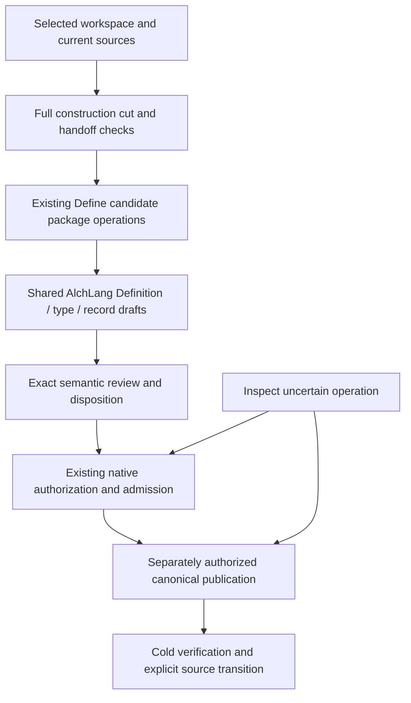

# Proposed AlchLang design for the definitions and records gaps

Status: candidate design, not executable implementation. The AlchLang blocks below are proposed resource excerpts. Dependencies, Entry access contracts, service declarations, schema contracts and Workflow profiles must be completed and checked by the existing compiler before execution. No compilation, admission, grant, registry transition or runtime activation is claimed.

## Scope correction — read first

SCOPE-BOUNDARY.md supersedes the broad lifecycle framing below. This document describes proposed shared Lab integration, not responsibilities all owned by Define. Lab work starts from intent/context and method applicability. Define is a semantic-preparation capability invoked when needed; the seven-stage chain is a construction dependency contract, not a universal task timeline. The illustrative DefinitionsRecordsFlow applies only when that particular combined method is selected; it is not a mandatory pipeline for every record or Product task.

## 1. Ownership and reuse

Define owns its existing meaning sessions, questions, contracts, candidate Pack construction, field lineage, materialization, inspection and replay. The shared Lab owns workspace context, record and Artifact Type creation, authority, native commit, repository publication and the coordinator that joins these capabilities. All Products call that same shared coordinator; no Product gets a copied Lab runtime.

Proposed additions extend the current module layout in place:

```text
workspaces/products/define/implementation/cli/alchlang/
  modules/work/                         extend scope import and explicit scope migration
  modules/packs/                        keep current package operations
  modules/lab-integration/              explicit shared-coordinator handoff
  runtime/cli.mjs                       transport only; invoke checked current Entries

implementation/lab-runtime/alchlang/
  modules/scope/                        Product/Project/Work preparation context
  modules/construction/                 exact cut, gate, coverage and invalidation
  modules/semantic-review/              exact review packet and dispositions
  modules/definitions-records/          one durable cross-product coordinator
  modules/definitions/                  reuse CreateDefinition
  modules/artifact-types/               reuse CreateArtifactType
  modules/records/                      reuse CreateRecord
  modules/transactions/                 reuse native target/effect/approval contracts
  modules/changes/                      predecessor-bound authoring and impact
  modules/publication/                  authorized repository publication plan
  modules/recovery/                     reuse existing ResolveOutcome behavior
  lab.alch                              existing protected native/creation resources
  definitions-records.alch               proposed bounded coordinator selection
  definitions-records-sources.json       explicit selection; no runtime copy
```

Keep Define, existing shared Lab operations and the coordinator in separate explicitly pinned compilation selections connected by bounded contracts and registered capabilities. One shared runtime may host multiple declared services/selections; this does not create a runtime per workspace. Share scope/type source by its one owned physical source selection, not by copying implementations. Existing compiler value, list and manifest limits remain unchanged; the coordinator must not concatenate every Define and Lab module into an oversized application.

The proposed boundary is:



A Definition supplies meaning; an Artifact Type supplies a carrier/schema/instance contract; a record is an instance. Reuse an existing carrier when adequate. These do not become three automatic creation steps.

## 2. Product preparation is distinct from native effect authority — G4

Owned by shared Lab context. Define imports the scope contract rather than maintaining a competing workspace model. Use a sum type so absence of Project is meaningful, not an empty or fabricated Project identifier.

```alchlang
module Lab.Scope version 1
use Lab.Shared.Ref
use Lab.Shared.Binding

enum PreparationScope:
  variant Product value ProductScope
  variant Project value ProjectScope
  variant Work value WorkScope

value-object ProductScope:
  workspace Ref
  product optional<Ref>
  selection_key Ref
  profile Binding

value-object ProjectScope:
  workspace Ref
  project Ref
  profile Binding

value-object WorkScope:
  workspace Ref
  project Ref
  work Ref
  membership Binding
  profile Binding

value-object NativeEffectContext:
  preparation_scope PreparationScope
  authority_route Binding
  native_branch Binding
  workspace_store_binding Binding
```

`product` preserves the selected profile's actual optional canonical Product reference. `selection_key` is the existing navigation key, such as product/define; it retains navigation-only standing. Current profiles can therefore prepare locally with a null canonical Product reference and no Project. A record or effect that requires a canonical Product identity must resolve one or retain an explicit gap/refusal; the key cannot become a fabricated global identity. A selected Goal has its own exact current membership evidence, with the same Project as selected Work where both exist.

Separate Operations:

- `SelectPreparationContext`: resolve the selected profile, Product/Project purpose and exact source cut. Product-only reads, candidate package preparation and draft validation need no fabricated native branch.
- `ResolveDraftCatalog`: select current carrier/schema observations for preparation without a store; schema-required Work/Project fields still require real records and cannot be invented.
- `SelectNativeEffectContext`: require the applicable authority route and a current replay-verified binding. Today's native Project writer requires a real selected Project/store. A future Product-native writer would require its own reviewed authority contract; this design does not assume one exists.

Existing `CreateDefinition`, `CreateArtifactType` and `CreateRecord` must evolve their preparation context from mandatory `Branch` to a selected catalog-preparation or native-branch context. Their effectful continuation remains gated separately. Do not silently reinterpret old Session records: an explicit converter or refusal preserves their source epochs and Project/Work membership.

## 3. One exact construction cut, with entry and completion gates — G2

Use the existing seven-stage contract and six adjacent handoffs. Before generation, bind the generation specification, not a future output digest. After generation, bind the real output manifest and independent conformance result. This avoids a circular proof in which generation must already be complete before it can start.

```alchlang
module Lab.Construction version 1
use Lab.Shared.Ref
use Lab.Shared.Digest
use Lab.Shared.Binding

enum Stage:
  value Definitions
  value Artifacts
  value BusinessOntology
  value BridgeOntology
  value SystemOntology
  value AlchLang
  value Generation

value-object Handoff:
  from_stage Stage
  to_stage Stage
  contract Binding
  source Binding
  target_specification Binding
  mapping Binding

value-object ConstructionCut:
  cut_id Ref
  definitions Binding
  artifacts Binding
  business Binding
  bridge Binding
  system Binding
  alchlang Binding
  generation_specification Binding
  handoffs List<Handoff,6>
  selected_profiles Binding
  selected_toolchain Binding

value-object ChainChecks:
  cut_digest Digest
  checked_digest Digest
  missing_handoffs List<Ref,6>
  invalid_adjacencies List<Ref,6>
  unresolved_mappings List<Ref,100>
  stale_dependencies List<Ref,100>
  incompatible_capabilities List<Ref,100>
  semantic_review Binding

operation CheckGenerationEntry:
  input cut ConstructionCut
  input checks ChainChecks
  output ConstructionCut
  on checks.cut_digest != checks.checked_digest reject construction-cut-mismatch
  on length(cut.handoffs) != 6 reject incomplete-construction-chain
  on length(checks.missing_handoffs) != 0 reject missing-handoff
  on length(checks.invalid_adjacencies) != 0 reject invalid-handoff
  on length(checks.unresolved_mappings) != 0 reject unresolved-mapping
  on length(checks.stale_dependencies) != 0 reject stale-construction-cut
  on length(checks.incompatible_capabilities) != 0 reject unsupported-profile
  return cut
```

This is an internal decision Operation, not an Entry accepting caller assertions that checks succeeded. The protected orchestration takes the source-bound cut, observes actual bytes through generic adapters, computes findings through native AlchLang rules and verifies the applicable review posture. `CheckGenerationEntry` illustrates only the final gate over that internally computed report. It is insufficient by itself to prove complete semantic adequacy.

The complete gate must additionally enforce:

1. Exactly one of each required adjacent handoff, in order; six duplicates must not pass a length check.
2. Each source/target binding matches the named stage in this cut. Ontology node identity and represented-subject identity remain separate.
3. Required mappings resolve to current resources; each profile and native capability fits the selected compiler.
4. Explicit source standing and review posture fit the intended claim. Candidate inclusion is never upgraded to admission.
5. Source bytes are rechecked at generation time, with toolchain/profile/input inventory pinned.
6. Completion validates every emitted member against the expected inventory and independent selected design checks; generated metadata cannot prove itself semantically sufficient.

The existing generic compiler stays generic. The shared Lab gate returns a bound zero-effect validation result; the builder checks it against its actual selected inputs. This is not permission to publish or execute operational effects. Bootstrapping the gate itself requires an explicitly selected reviewed tool/profile and independent gate qualification; it must not self-approve a new implementation merely by generating itself.

## 4. A durable coordinator, with existing services as owners — G3

The shared coordinator retains small bindings and exact identifiers, not full JSON bodies, credentials or session memory. Each stage has an immutable receipt; retries inspect by run/stage/attempt identity.

```alchlang
module Lab.DefinitionsRecords version 1
use Lab.Shared.Ref
use Lab.Shared.Binding
use Lab.Scope.PreparationScope

enum RunPhase:
  value Preparing
  value AwaitingSemanticReview
  value AwaitingNativeApproval
  value LocalCommitted
  value AwaitingPublicationApproval
  value CanonicalPublished
  value Reconciling
  value NeedsRevision
  value Deferred
  value Refused
  value Invalidated

entity Run:
  id UInt64
  scope PreparationScope
  construction_cut Binding
  phase RunPhase
  identity id

entity StageReceipt:
  run_id UInt64
  stage Ref
  attempt UInt64
  inputs Binding
  result Binding
  identity run_id, stage, attempt

workflow DefinitionsRecordsFlow:
  owner LabWorkflowService
  scope generated-recoverable
  profile contracts/definitions-records-workflow.json
  input id UInt64
  input request RunRequest
  correlation id
  durable-state Lab.DefinitionsRecords.Run
  start Lab.BeginDefinitionsRecordsEntry
  step preparation invokes Lab.PrepareDefinitionsRecordsEntry
  step semantic_review invokes Lab.PrepareSemanticReviewEntry
  step local_admission invokes Lab.PrepareLocalAdmissionEntry
  step publication invokes Lab.PrepareRepositoryPublicationEntry
  recovery needed-compensations-only reverse-completion
```

`RunRequest`, the LabWorkflowService declaration, stage tickets, continuation Entries, access declarations, stage result types and the four-stage Workflow profile are design obligations, not existing registered resources. Their exact implementation capability digests must be real before this Workflow can be compiled/admitted. No guessed digest or placeholder runtime capability may pass the gate.

Stage adapters call existing checked resources. This design does not assume an unsupported nested-Workflow language feature or a cross-service atomic transaction:

| Stage | Existing owner/behavior reused | Result |
|---|---|---|
| Preparation | Define source capture, package, materialization; shared AlchLang creation Operations | Package, exact drafts, unsigned proposal and receipts |
| Semantic review | Selected applicable semantic owner route | Exact approve/reject/revise/defer observation |
| Local admission | Existing ApplyEligibility, AdmissionLifecycle, native dispatch and Store.apply | Observed native transaction and histories |
| Publication | Separately selected repository owner/writer | Verified canonical postimages and explicit source transition |

Preparation/inspection remains useful when effects are not authorized. Review may return NeedsRevision, Deferred or Refused; these are persisted outcomes, not automatic retries. Publication may remain awaiting approval after a successful local commit. Coordinator completion must report which of candidate preparation, local commit and canonical publication was actually requested and observed.

Add Events for `SemanticReviewRequested`, `StageOutcomeObserved` and `PublicationObserved`, plus Queries scoped by run identity, workspace and exact source cut. Events notify; they do not grant access or turn an unpublished record into a canonical one.

## 5. Creation decisions execute through AlchLang — G5

Reuse the current resources:

```alchlang
use Lab.Definitions.CreateDefinition.CreateDefinition
use Lab.ArtifactTypes.CreateArtifactType.CreateArtifactType
use Lab.Records.CreateRecord.CreateRecord
use Lab.Transactions.PrepareCreation.PrepareCreation
```

Those symbols already exist. Their context contracts must be extended deliberately where Product preparation is selected; this design does not claim the old Branch-only signatures already support it.

The public creation route becomes:

```text
explicit authored bytes and selected context
  -> generic immutable byte/schema observations
  -> existing AlchLang creation Policy and Operation
  -> AlchLang Mapping of the native proposal target
  -> independent native review/precondition check
  -> exclusive publication of the inert draft
```

Python/JS can retain generic file, hash, schema, encoding, signing-library and transport mechanics, and the existing native writer retains its authority checks. The direct native helper must no longer independently choose draft scope, classification, effect, placement, candidate eligibility or dependency policy that should be owned by AlchLang. This is a shared Lab change, not restoration of the retired Python Define engine.

The non-fixture native document-stage adapter must establish real current context, source/HEAD, selected store, exact approval bytes and applicable authenticated actor. It must independently recheck the target before native dispatch. A typed `SignatureVerified` value supplied as JSON is not forge-proof permission. Readiness and execution authority remain distinct.

## 6. Semantic review is an observed exact disposition — G1

```alchlang
module Lab.SemanticReview version 1
use Lab.Shared.Ref
use Lab.Shared.Binding
use Lab.Shared.Digest

enum Disposition:
  value Approve
  value Reject
  value Revise
  value Defer

value-object ReviewPacket:
  packet_id Ref
  exact_targets Binding
  construction_cut Binding
  intended_effects Binding
  applicable_owner_route Binding
  semantic_evidence Binding

value-object ObservedDisposition:
  packet_digest Digest
  owner_outcome Binding
  disposition Disposition
  scope_binding Binding
  source_cut Binding
```

The protected review observer verifies the actual applicable owner response against these exact inputs, rather than generating one. Record all four dispositions. Approve may satisfy the selected semantic review gate; it is not automatically a native approval, repository publication permission or proof that future changed bytes were reviewed.

The existing five candidate meanings and contract packet are the first pending review subject. This design reuses them; it does not create replacement global meanings to escape their pending admission.

## 7. Repository publication is its own exact effect — G6

```alchlang
module Lab.Publication version 1
use Lab.Shared.Ref
use Lab.Shared.Binding

enum PublicationOutcome:
  value Prepared
  value AwaitingAuthority
  value Published
  value Unknown
  value Refused

value-object Replacement:
  logical_path Ref
  predecessor optional<Binding>
  postimage Binding

value-object PublicationPlan:
  plan_id Ref
  local_transaction Binding
  exact_owner_outcome Binding
  carrier_compatibility Binding
  replacements List<Replacement,100>
  consumer_transition Binding
  expected_source_cut Binding

operation PreparePublication:
  input request PublicationRequest
  output PublicationPlan
  enforce PublicationEligibility(request=request)
  return ToPublicationPlan(request)
```

`PublicationEligibility` and `ToPublicationPlan` are proposed Policy/Mapping resources. They must select deterministic exact postimages for Definitions, registry, index, human projections, drift material and required state/source changes, with unchanged historical meanings preserved. A compatible Definition/v1-to-selected-v2 publication contract must be reviewed explicitly; no mixed-carrier registry is inferred.

Authorization binds the deterministic plan/preimages/postimages and current authority context before publication. The resulting publication receipt is produced afterwards, avoiding a signature/output/receipt cycle. A local admission signature is reused only if its explicitly authorized effect already covers this distinct repository publication; otherwise obtain the separately applicable authority.

There is no assumed atomic multi-file repository writer today. Select an actual supported publication backend and its visibility contract. If immutable staged bundles plus one manifest pointer are chosen, dependent readers must be migrated and verified against that pointer. Otherwise staged mixed files must not be advertised as one coherent current cut. Completion requires cold verification of all planned postimages and the explicit source transition; Git commit/push alone is not canonical admission.

An interrupted publisher returns Unknown and preserves evidence. Recovery inspects the exact original publication operation before considering another write. A native local commit can remain valid even when repository publication is incomplete; there is no fabricated rollback of that committed fact.

## 8. Revisions, withdrawal and impact reuse the native effect model — G7

```alchlang
module Lab.Changes version 1
use Lab.Transactions.Target
use Lab.Transactions.Effect
use Lab.Shared.Ref
use Lab.Shared.Binding

value-object ImpactSelection:
  predecessor Ref
  dependency_cut Binding
  affected_subjects Binding
  required_requalification Binding

operation RequireChangePredecessor:
  input target Target
  output Target
  on target.effect == Admit and present(target.predecessor) reject unexpected-predecessor
  on target.effect != Admit and absent(target.predecessor) reject predecessor-required
  return target
```

This is only a new authoring gate. Existing native `prepare` still independently checks exact current predecessor, identity, revision/withdrawal semantics, active carrier/Definition dependencies and relations. Do not copy that writer into Define.

`PrepareChange` must preserve the operation's native shape: a withdrawal names the current exact version and has no authored successor body; a revision supplies its exact predecessor and new body. Typed impact analysis additionally covers design mappings, generated outputs and consumers. Old results remain historical evidence but cannot pass as current conformance after a transitive dependency changes. Explicit bounded continuation protocols cover large sets within current compiler limits.

## 9. Recover by inspection; never blindly retry effects

Extend coordinator state while reusing `Lab.Recovery.ResolveOutcome` and native `AdmissionLifecycle`:

```alchlang
module Lab.DefinitionsRecords.Lifecycle version 1
use Lab.DefinitionsRecords.RunPhase
use Lab.DefinitionsRecords.RunSignal

state-machine RunLifecycle:
  state RunPhase
  input RunSignal
  initial Preparing
  terminal CanonicalPublished, Refused, Invalidated
  transition Preparing PreparationObserved -> AwaitingSemanticReview
  transition AwaitingSemanticReview ReviewApproved -> AwaitingNativeApproval
  transition AwaitingSemanticReview ReviewRevised -> NeedsRevision
  transition AwaitingSemanticReview ReviewDeferred -> Deferred
  transition AwaitingSemanticReview ReviewRejected -> Refused
  transition AwaitingNativeApproval LocalCommitObserved -> LocalCommitted
  transition LocalCommitted PublicationRequested -> AwaitingPublicationApproval
  transition AwaitingPublicationApproval PublicationObserved -> CanonicalPublished
  otherwise reject invalid-run-transition
```

`RunSignal` must be declared in the proposed contracts and constructed by protected observation continuations. The excerpt is the successful authority progression, not a claim that recovery transitions are fully specified by those lines.

For uncertain native admission or publication, keep a separate immutable `PendingEffect` with its kind, exact operation ID, input bindings and return phase. Preserve it before dispatch. Suspend progression; inspect through the original owner. Committed/Replayed retains the real receipt; Unknown stays pending; proven no-effect returns to the appropriate review/authorization route; refusal retains its reason. A changed input creates an explicit successor request, never a repeat of the old authorized operation. No automatic compensation may undo an authoritative commit.

## 10. Successor mappings, claim levels and implementation order — G8

Create a reviewed successor of the old language projection. Keep the original frozen review packet unchanged.

| Old support reference | Current owned realization to map |
|---|---|
| Python capture | Define LocalCaptureProtocolValue and native capture policies |
| Python prepare | Define PreparationProtocol parts, CandidatePack parts and validation roles |
| Python materialize | Define MaterializationProtocol and fidelity/lineage operations |
| Old materialize as semantic-review support | Current exact materialization evidence plus an independent applicable semantic owner response; materialization alone is not review |
| Deleted connector reconstruct | Current FrozenInspectionProtocol, native package reconstruction and shared byte custody |

Per mapping and receipt, retain claim level: candidate, fixture-only, verified local native effect, or canonical publication. One common complete flag cannot merge them. Source standing, evidence confidence, semantic commitment and execution permission retain their existing separate meanings.

Implementation order:

1. Review/resolve the existing semantic contract and carrier/publication selection; produce current successor source/design mappings.
2. Extend scope and draft context; implement/qualify the construction gate using the reviewed bootstrap route.
3. Route the current creation CLI through existing AlchLang operations and qualify the real authenticated native adapter.
4. Add coordinator persistence, review handoffs and exact native transaction correlation.
5. Add separately authorized publication/source transition and lifecycle/impact helpers.
6. Qualify the complete selected workflow with denial, stale input, duplicate identity, bad membership, missing handoff, changed design, crash, no-effect, unknown publication and fresh-process replay cases.

Only the selected semantic owner can supply the missing admission outcome. These code-shaped design excerpts are not an approval flow, an implementation waiver, or proof of a compiled compliant runtime.

## Definitions Governance Summary

- Definitions updated: none; 46 exact existing meanings selected, including the five unadmitted review targets.
- Index synced: design resource index only; canonical indexes unchanged.
- Drift found: five older resource-support references need a reviewed successor mapping.
- Undefined critical terms: new technical resource contracts remain proposed; no new global normative identities are claimed.
- Conflicting consumers: compatible Definition/v1/v2 publication and reader visibility remain explicit design obligations.
- Validation: source bindings and design coverage can be checked structurally; AlchLang compilation and execution have not been performed.
- Follow-ups: complete protected Entry/profile/type contracts, owner dispositions and independent checks before implementation/activation claims.
