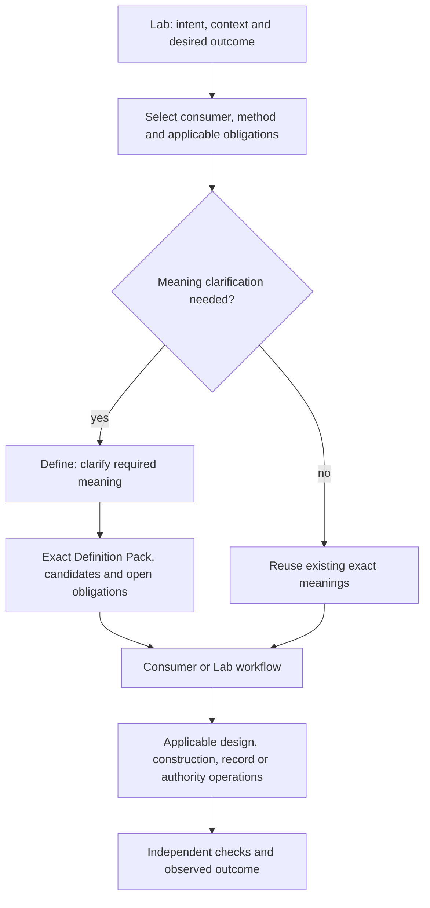

# Scope correction: Define alone versus Lab construction

This corrects the scope framing of DESIGN.md. It is a design clarification, not a canonical semantic amendment, implementation or admission. The existing CyberAlchemy Define and Definition Pack meanings are authored unadmitted candidates; their intended boundary is compared here with current AlchLang realization.

## Entry and responsibility

Lab work begins with originating intent, context, a bounded desired outcome and a named consumer/use. The Lab or selected consumer assesses the work and selects the applicable method and obligations. Define is invoked when meanings must be found, clarified, proposed, specialized or left explicitly open.

The definitions → artifacts → business ontology → bridge → system ontology → AlchLang → generation chain describes logical dependencies for the selected construction/conformance method. It is not a universal first activity for every task and is not Define's lifecycle. It may reuse exact existing definitions and qualified realizations. An ordinary record under an existing carrier does not require creation of fresh definitions, ontologies or software merely to run a general construction pipeline. Changes to meaning, carrier or implementation trigger their applicable dependency and conformance obligations.

## Define owns

1. Preserve the supplied bounded goal, originating intent, declared context and named consumer/use. Expose insufficient input or contradictions; do not silently replace the intent or choose a solution.
2. Identify the declared required concepts and examine reusable meanings with their exact identity, revision, applicability and source standing.
3. Ask questions, record attributable responses, expose ambiguity, missing meaning and owner-route gaps.
4. Record exactly one current reuse/specialize/propose/open disposition per declared required concept. This proves coverage of that declared set, not discovery of every relevant concept.
5. Record explicit meaning parameters, application context and semantic contract constraints needed by the named use, plus unresolved obligations and bounded validation scope.
6. Freeze and revise a reviewable Definition Pack, retaining intent, evidence, lineage, relationship scope and source standing.
7. Own its preparation artifacts: sessions, question/response records, source bindings, candidate packs, reports and explicitly selected candidate Definition materializations/projections/lineage. A pack may yield zero, one or many candidate Definitions.
8. Inspect, reconstruct and replay its own exact retained preparation outputs. Report bounded checks and blockers; hand off the exact pack/candidates and their residue.

## Define does not own

- Choosing the Product solution, system architecture, implementation approach or applicable construction method for the consumer.
- Enforcing the entire Lab construction pipeline, creating business/bridge/system ontology as a universal automatic continuation, generating the consumer implementation, or certifying full consumer conformance.
- Registering arbitrary Artifact Types or creating arbitrary business records such as Work, Goal or Decision records. Those are shared Lab capabilities; Define's own session and pack artifacts are not an exception that makes it the general record engine.
- Assigning owners, accepting its own candidate meanings, authenticating an organization, granting permissions, signing or applying authority transactions, publishing canonical registry/source transitions, or operating another Product.
- Turning readiness or schema validity into semantic acceptance, operational authority or proof of suitability for all consumer uses.

Define may identify and prepare a requested handoff to these owners. A Define-facing convenience command may delegate to shared Lab operations, but this does not move their semantic or effect ownership into Define.

## Correct orchestration

The owner of construction enforcement is the shared Lab construction/method capability. Its first decision is applicability and context, not unconditional creation of Definitions. Once implementation-bearing construction is selected, it enforces the required semantic/design/source dependencies before claiming conformant generation. It consumes Define outputs when relevant and can block its own next step without making Define own that step.

## Reclassify the eight audit gaps

| Gap | Correct owner | Define's portion |
|---|---|---|
| G1 semantic admission | Applicable semantic owner / Lab governance | Prepare exact candidates, evidence and review handoff; retain actual outcome without self-admission |
| G2 construction enforcement | Shared Lab construction/method capability | Preserve exact semantic input references and residue; do not run the universal construction gate as Define's own outcome |
| G3 cross-stage coordinator | Shared Lab / selected consumer method | Expose a precise resumable handoff for its pack and prepared candidates |
| G4 scope/context | Shared workspace contract; Define uses it | Accept Product-only semantic preparation and preserve real Project/Work membership where selected |
| G5 record/type creation execution | Shared Lab creation and native authority owners | Delegate explicitly when requested; keep Define's own preparation decisions in AlchLang |
| G6 canonical publication | Applicable repository/semantic governance | Supply exact prepared outputs and source standing; do not treat local confirmation as publication |
| G7 evolution | Define for its packs/candidate meanings; Lab for records, authority and transitive consumer impact | Explicit semantic/pack successors and exact lineage, without generic record withdrawal or consumer regeneration ownership |
| G8 realization mapping | Each capability owner; shared Lab checks integration | Correct Define's current resource mappings and scope its evidence honestly |

## Narrow Define design boundary

Input: bounded goal + originating intent + selected context + named consumer/use + available evidence.

Output: exact reviewable Definition Pack + zero or more selected candidate Definitions + explicit open obligations and bounded validation results.

The next Define-only design should cover context selection, concept discovery/lookup, clarification, meaning disposition, parameter/application contracts, pack revision, materialization fidelity and handoff. Generic record creation, construction enforcement, native admission and canonical publication remain separately owned integration designs.
