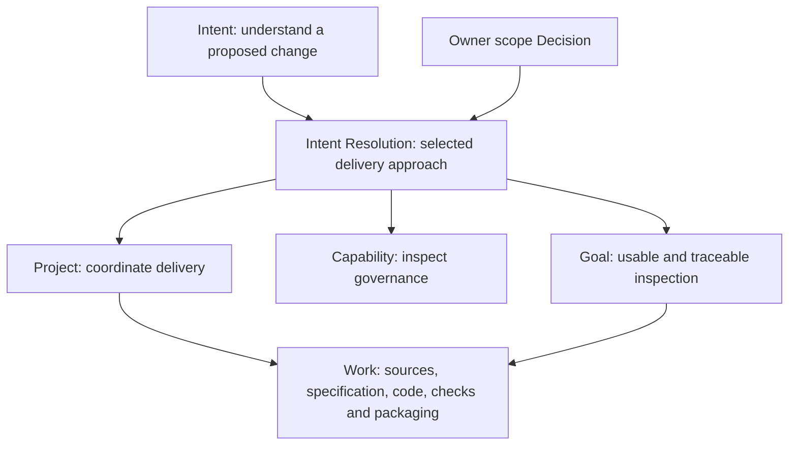
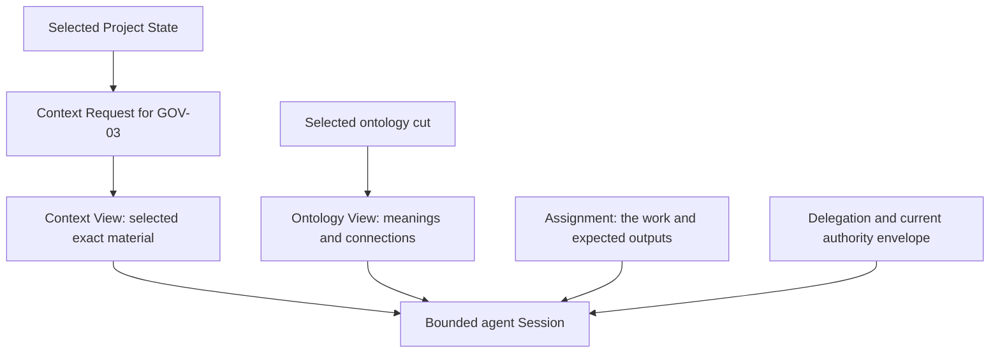
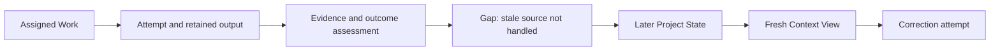
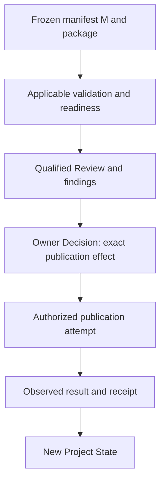

# Following a Governance feature from Intent to release

This walkthrough follows one feature: **let a person or agent inspect a proposed Definition change and see its governing rules, sources, separate states and unresolved gaps**. The first delivery is read-only.

These are illustrative excerpts mapped to repository contracts. The scope choices, owners, permissions, executions, observations and release outcomes below are fictional. They do not resolve the real Definition Pack's open questions. No implementation, operational record, admission or release was performed.

## 1. Give the effort a purpose and an owner

The [existing Definition Pack](../0009-governance-feature-example-pack/README.md) supplies the meanings, task applications and unresolved questions. It is an input to delivery; it does not create the delivery plan or authorize effects.

| Record | Example content | Why keep it? |
| --- | --- | --- |
| Intent | Help people and agents understand how a proposed Lab change is governed. | Keeps the reason for doing the work. |
| Scope Decision | For this illustrative first delivery, inspect Definition changes and exclude automatic approval. | Records who selected this boundary and on what basis. |
| Intent Resolution | Select the Governance Project and capability; use the Goal to express the satisfaction conditions. | Connects the direction to the selected delivery approach. |
| Project | GOV-001: deliver Governance inspection. | Coordinates the people, work and accumulated results. |
| Goal | An intended user can inspect an exact proposal, identify its sources and constraints, and see what remains unknown. | States the outcome and evidence requirements. |
| Product Capability | Governance inspection in the CyberAlchemy Lab Product. | Describes the continuing ability the Product should provide. |



Arrows in these diagrams explain the flow. They do not declare new ontology relation kinds. Actual relations must use the permitted typed endpoints and declared contracts.

## 2. Break delivery into bounded Work

An illustrative delivery sequence is:

| Work | Expected result | Depends on |
| --- | --- | --- |
| GOV-01 — select sources | Exact source selection and a report of incompatible or stale inputs. | Definition Pack and relevant Lab contracts. |
| GOV-02 — specify behavior | Input/output contract, independent status fields, missing-source behavior and acceptance conditions. | Reviewed source selection. |
| GOV-03 — implement projection | Candidate code and implementation notes. | The exact selected specification and sources. |
| GOV-04 — present the inspection | A readable view with source links and visible gaps. | The projection contract. |
| GOV-05 — assess the candidate | Conformance evidence and bounded outcome assessments. | Exact implementation revisions. |
| GOV-06 — examine actual use | A bounded user walkthrough, observations and remaining limitations. | The candidate interface. |
| GOV-07 — prepare release | Frozen package, documentation, dependencies and release-review inputs. | Required evidence and resolved blocking findings. |

This is a proposed sequence, not seven created operational Work instances. The first three have reader excerpts in [record-excerpts.json](record-excerpts.json).

For example, the implementation Work starts with:

```yaml
node_id: example:work:GOV-03-projector
payload:
  project_ref: example:project:GOV-001
  goal_refs: [example:goal:GOV-001]
  work_statement: Implement the selected governance projection against the exact inspection contract.
  input_refs:
    - example:source:inspection-spec@1
    - example:source:source-selection-report
  completion_state: planned
```

**A current contract question:** Work/v1 requires at least one `output_refs` entry even before execution. The excerpt deliberately omits it. Before creating complete planned Work records, we must establish whether an output reference may name an explicitly unresolved planned target, or prepare a compatible contract amendment. Agent Assignment already has a separate `expected_output_refs` field. An expected output must never be presented as evidence that an output exists.

The older Governance candidate also pins an earlier Definition registry and projects a narrower set of foundation artifacts. Source selection must address both the old binding and the projection's subject coverage. Replacing a digest alone would not establish compatibility.

## 3. Prepare the agent's context

The **Coordination Context** establishes the continuing purpose: build and assess the Governance feature for one Product, one Project and one primary Goal. It can serve several Work items and sessions while those anchors remain appropriate.

The **Context Request** asks for the material needed for this particular Work. For GOV-03, it selects the Pack, specification, source-selection report and relevant current definitions. It excludes unrelated projects, private keys and private session memory.

The **Context View** is the immutable, source-bound result of that selection. It records which source epoch was observed, what was included or excluded, why it was selected, its limits and expiry.

```yaml
node_id: example:context-view:GOV-03@1
request_ref: example:context-request:GOV-03@1
context_ref: example:context:GOV-build@1
context_version_ref: example:context:GOV-build@1
source_epoch: example:Project-State-S17
generated_at: EXAMPLE-T0
expires_at: EXAMPLE-T0-plus-20-minutes
included_material:
  - source_ref: define/proposals/0009-governance-feature-example-pack/pack.json
    selector: /
    sha256: 30f8a4bc7545f097bc88eeadd7d8f19bd3baeed53101e86486d7e68fda25aeb7
```

The Pack digest above identifies actual local example bytes. S17, the times and the view itself are fictional. A real view would also bind the actual specification and source report and include the remaining required metadata. The twenty-minute period is an illustration, not a Lab default.

The **Ontology View** supplies the selected meanings and supported connections at an exact ontology cut: for example Authority, Provenance and the Governance-Axis Independence Invariant. It needs its own cut digest, cursor, policy, exclusions and freshness information. It does not authorize actions or become the replay source.



## 4. Give the agent an assignment and permitted actions

Three records answer different questions:

| Record | Question | GOV-03 example |
| --- | --- | --- |
| Agent Assignment | What is this eligible agent expected to do? | Implement GOV-03; return candidate code and notes; stop if the selected sources change. |
| Delegation | Which actions may it perform, where and for how long? | Read selected inputs, write owned candidate code and record permitted evidence within the development sandbox. |
| Agent Session | Which particular ephemeral instance is working with which inputs and bounds? | Instance 03, Assignment 03, Context View 1, Ontology View 1 and a current authority envelope. |

An excerpt of the Session is:

```yaml
payload:
  agent_instance_ref: example:machine-instance:03
  assignment_ref: example:assignment:GOV-03@1
  context_view_ref: example:context-view:GOV-03@1
  ontology_view_ref: example:ontology-view:GOV-03@1
  authority_envelope_ref: example:authority-envelope:03
  input_refs: [example:work:GOV-03-projector@draft1]
  session_memory:
    selected_input_refs:
      - define/proposals/0009-governance-feature-example-pack/pack.json
    working_record_refs: []
    unresolved_questions: [Native reviewer-route qualification.]
    expires_with_session: true
```

The complete excerpt collection also shows policy, budget, period, revocation and stop-condition fields. A real current grant must be checked; possessing a Context View does not grant permission to publish, approve a Definition, deploy or write production state.

**The machine agent is ephemeral.** Its short memory belongs to the Session. Results selected for retention become source-bound project records through the applicable interfaces. Future sessions reconstruct what they need from Project State, Context Views and Ontology Views; they do not inherit an earlier instance's private working memory.

## 5. Record an attempt, then assess its result

Suppose the first candidate handles normal sources but fails to identify a changed registry. The agent has performed work, but the expected behavior has not been established.

The retained output receives a Source record with a real locator, digest, capture time and provenance. A new exact Work revision can then refer to that produced output:

```yaml
payload:
  project_ref: example:project:GOV-001
  goal_refs: [example:goal:GOV-001]
  work_statement: Implement the selected governance projection against the exact inspection contract.
  input_refs: [example:source:inspection-spec@1]
  output_refs: [example:source:projector-attempt1]
  completion_state: attempt-result-recorded; expected outcome not yet satisfied
```

A **Work Outcome Assessment** compares the expected and observed result:

```yaml
payload:
  subject_ref: example:work:GOV-03-projector@r2
  expected_result_ref: example:source:inspection-spec@1
  observed_result_ref: example:source:projector-attempt1
  evidence_refs: [example:source:attempt1-check-results]
  disposition: requires-correction-in-scenario
  gap_refs: [example:gap:missing-source-check]
```

These values are readable scenario labels, not an established lifecycle vocabulary. `r2` identifies an illustrative external record revision; it is not an added Work schema field. The source digest remains unbound in the JSON example because no actual code or execution was produced.

The correction is recorded, not hidden. Project State can then expose the saved attempt, assessment and gap. A new request produces Context View 2 at the selected later epoch. View 1 remains unchanged. If Session 03 ended, a fresh ephemeral instance receives a new Session, assignment and current permission as needed.



A reusable operational lesson can be proposed from this experience if warranted. One failure need not create a new shared Definition. The Pack keeps task-specific values and assessments; shared meaning changes follow their own review and owner route.

## 6. Bind the implementation to the capability

After correction, the **Implementation** record identifies the candidate realization, the schemas it claims to conform to, its entrypoint and environment contract. Exact source, build and dependency bindings are still required for actual delivery.

An **Evidence Set** groups the relevant observations and their limits. An **Evaluation** applies an actually selected profile to the exact candidate and input state. Example coverage includes changed sources, unknown ownership, independent governance states and a bounded user walkthrough.

The **Capability Realization Binding** makes the association explicit:

```yaml
capability_ref: example:capability:governance-inspection@1
capability_version_ref: example:capability:governance-inspection@1
realization_refs:
  - example:implementation:GOV-inspector@0.1.0-candidate.2
binding_state: candidate
adoption_decision_ref: null
conformance_refs: [example:evaluation:GOV-candidate@1]
observation_refs: [example:source:bounded-user-walkthrough]
```

The binding says which realization is being considered for which capability version. Candidate code, a favorable evaluation, Product adoption and demonstrated ongoing value remain separate facts. The evaluation profile and observations in this story are placeholders, not qualified evidence.

## 7. Freeze and review a release candidate

Now assemble the selected implementation bytes, dependencies, environment requirements, evidence, documentation and known limits. Freeze the technical release manifest and give those exact bytes a binding, **M**.

M is a symbol for a future exact binding, not a fabricated digest. The manifest does not contain its future release Decision. This avoids a circular dependency between manifest bytes and a Decision that must identify them.

Release review has a different purpose from implementation work. It receives a separate release Coordination Context, fresh views of the candidate/evidence and the applicable review permissions.

| Record or document | What it establishes |
| --- | --- |
| Frozen release manifest M | Exactly which candidate, package, environment, dependencies and documents are under consideration. |
| Validation and readiness evidence | What was checked, which obligations were met and which gaps remain. |
| Review | Applicable profile, qualified reviewers, findings and a bounded recommendation about M. |
| Owner Decision | Whether the exact selected effect is permitted within the owner's actual scope. |

The selected [Define integration design](../0008-revised-runtime-integration-design/REVIEW-HANDOFF.md) requires retained exact material, immutable review preparation, independent native validation and review, and the actual scoped owner route. Those host extensions remain design work awaiting implementation. Define can prepare a handoff; it does not appoint the reviewer or turn the Pack into approval.

**Current release-route limit:** the inspected native release-preparation candidate requires the whole Lab's 34 operations and 13 Product acceptance conditions. Its result is `blocked` or `ready-for-final-review`; it creates no release Decision and performs no publication or activation. This narrower feature must either join that whole-Lab release or have a separately reviewed feature-release route. This walkthrough does not silently narrow the existing handler.

No dedicated Release Artifact Type is assumed here. The manifest, readiness report and publication receipt are proposed technical documents retained through appropriate Source/Evidence records.

## 8. Decide, publish and observe the effect

After the applicable readiness and review requirements are satisfied, the qualified release owner can decide about M:

```yaml
payload:
  decision_maker_ref: example:principal:qualified-release-owner
  subject_refs:
    - example:release-manifest:GOV-0.1.0
    - example:binding:GOV-inspection@candidate1
  selected_outcome: EXAMPLE accept exact bounded feature release for the explicitly selected publication target.
  evidence_basis_refs:
    - example:evaluation:GOV-candidate@1
    - example:release-readiness:GOV-0.1.0
    - example:review:GOV-release-0.1.0
  declared_effect_refs:
    - example:effect:publish-exact-feature-package-M
```

The publisher then needs its own current permission for the exact destination and action. A technical receipt binds M, the Decision, the destination and the observed published digest. The observed bytes must match the selected bytes. If publication fails, preserve that result and the recovery requirements; the Decision alone does not establish a published release.



Changing the selected package or release-relevant evidence requires checking the applicable freshness/compatibility rules and obtaining fresh assessment and approval where required. A previous Decision is not permission to publish arbitrary successor bytes.

Capability adoption is an additional explicit outcome. The JSON collection shows a separate Product-owner Decision targeting the exact candidate binding and a conditional adopted successor after the authorized adoption effect is verified. Publication does not create that successor automatically.

Installation, runtime activation and production deployment also require their applicable contracts, permission and observed-effect evidence. A published package can therefore exist without an installed or running service.

## 9. What the next session can reconstruct

The final illustrative **Project State** identifies its Project, cursor, artifact references, Decision references, semantic history, governance history and digest. It can expose the exact implementation, review, adopted binding and retained manifest/receipt Sources. It is a selected projection of recorded state, not the agent's recollection.

The next agent can answer:

- What was intended, selected and excluded?
- Which Work produced this implementation, and which attempt failed first?
- What exact evidence supports the current claims?
- Who decided to publish which bytes, where, and what actually happened?
- Was the capability separately adopted? Is anything installed or active?
- Which gaps and limitations remain?

This is how work carries forward through time: persist the results, provenance and governing outcomes; build fresh views for the next bounded Session. The feature release does not automatically close the Goal or terminate the Project. Their actual outcome and continuing support needs must be assessed under the applicable rules.

## Current preparation and open requirements

This package contains **33 illustrative excerpts across 22 existing carrier schemas**, plus proposed technical documents. Each excerpt lists omitted required fields; none is advertised as a complete operational instance. Links inside fields are not a substitute for exact version/digest resolution, typed relations or applicable validation.

Three journey questions are recorded in [gaps.json](gaps.json): planned Work output semantics, the bounded feature-release route, and separate adoption/publication effects. The original Pack's Q01–Q05 remain open. All owner choices and successful outcomes above are hypothetical.

Files:

- [Record excerpts](record-excerpts.json): concrete fields, narrative links and omitted-field lists.
- [Source baseline](source-baseline.json): exact schema, source and candidate-code bindings used to ground the explanation.
- [Gap register](gaps.json): remaining decisions before operationalizing the journey.
- [Document integrity report](validation.json): reference/hash/field-name checks only, not runtime or schema qualification.
- [Package manifest](manifest.json): exact document members; no release or governing effect.
