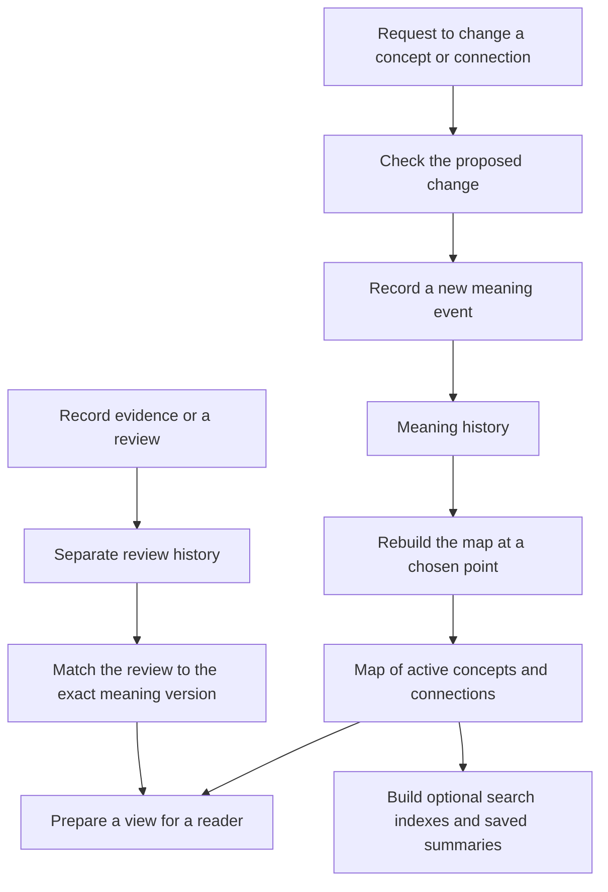

# Ontology Lifecycle architecture

Ontology Lifecycle turns a recorded history of concepts and connections into a
map that people and software can read. This document explains the parts of that
process and why each part exists.

Start with the [README](README.md) for a short introduction. The example below
uses the same imaginary parcel delivery product.

## The map and its history

The map contains **nodes**, which represent things, and **relations**, which
connect them. For example, Parcel Desk is a product, Track a parcel is a
capability, and a relation connects the two.

A connection is also a record with its own identity and history. It can change
or leave the map independently of the things it connects.

Each identity belongs to a particular ontology and has a declared type.
Changing a display name does not create a new identity. Giving two things the
same name does not make them the same thing.

The history records changes in order. Each change contains the complete state
of one node or relation after that change. To find its state at a chosen point,
the system selects its most recent change up to that point.

The code calls this way of keeping history **event sourcing**.

## The main parts



The arrows describe the responsibilities in the design. A command or adapter
must call the implementation; the diagram does not imply a running service.

### 1. Checks before a change is recorded

The Rust library checks the identity, content, expected history version, and
event fingerprint. A fingerprint is a value calculated from the contents; a
different value shows that the recorded contents changed.

It also checks whether the requested lifecycle change is allowed. A retired
entry can return to active use. A removed entry cannot receive another meaning
or lifecycle change.

The library has operations for adding meaning events and separate review
events. It can add related meaning changes as a batch. These operations do not
supply general permission to change Lab records; that belongs to the caller's
separate approval process.

### 2. Meaning history

A meaning event records the full result of a change to one concept or
connection. It includes its identity and a reference to its preceding event.

Suppose Track a parcel first means “show the last reported location.” The team
later changes it to “show location and estimated arrival.” The second event
contains the new description. The first remains in the history.

A correction therefore adds a new event. Editing an earlier event would break
the history checks.

The code uses the word **semantic** for this meaning-bearing history.

### 3. Review and evidence history

The package also records where information came from, assessments of evidence,
questions about a claim, unresolved issues, and who should resolve them.

These records belong to a separate history. A review references the exact
meaning event it concerns using its identifier, fingerprint, and position in
the history.

For example, evidence that supported the original tracking description does not
automatically support the later promise about estimated arrival. A view that
requires a review of the new version must find one that matches that version.

The system also keeps confidence in the evidence separate from the degree of
commitment to using a claim. Those answer different questions.

The code calls these records **governance events**. Recording one does not by
itself authorize an action elsewhere in the Lab.

### 4. Rebuilding a consistent map

A reader chooses a numbered position in the meaning history. The code calls
that number a **cursor**.

At that position, the system finds the latest state of each node and relation.
It includes active entries in the usable map and checks that every active
relation points to active nodes in the same ontology.

This prevents a map from showing an active connection to a capability that is
already retired or removed. Retired and removed entries remain in the history
and saved subject summaries even though they are absent from the active map.

The result is called an **ontology cut**: the map calculated at that exact
position. Rebuilding from the same valid history and position produces the
same result.

A meaning cursor selects a point in meaning history. Reviews are matched to
the selected meaning versions; this is not a promise that every review shown
was already known at the original wall-clock time.

### 5. Preparing a view for a reader

A consumer may need only part of the map. A task about parcel tracking does
not need every unrelated product and capability.

A request names the point in history, the entries needed, and the intended
use. The system prepares a view with references back to its source events.
The context adapters wrap that result for their consumers.

When a request requires an exact review and that review is missing, the system
returns an error. It does not substitute an assessment of a different version.

The code calls this calculated result a **projection**. Preparing one does not
create a new history or approve its contents.

### 6. Making reads faster

Saved subject summaries and checkpoints let the system reuse earlier work.
A checkpoint records a calculated state at a known position. The system can
check it and read the later events to rebuild the requested state.

A separate graph read-model candidate adds indexes for finding entries,
following connections, and selecting parts of the map. It also experiments
with updating the calculated graph while readers keep a complete earlier view.

These are ways to serve recorded information more efficiently. The event
history remains the source for reconstructing ontology state. A generated
index or view cannot replace it.

## Different agents can use different versions

An agent may need a stable understanding of the map for the duration of a task.
Another agent may need the latest information. They should be able to do that
work without forcing each other to use the same version or keeping the shared
state locked throughout either task.

For example, Agent A can keep a view calculated at position 23 while Agent B
uses one calculated at position 47. Recording newer events does not rewrite
the earlier meaning history. Agent A can finish its work and then explicitly
choose to obtain a newer view.

There are two supporting mechanisms in the code:

- The core library can rebuild maps at different meaning-history positions.
- The graph read-model candidate lets a reader retain an unchanged snapshot
  while a writer prepares and publishes the next version. A snapshot already
  held by a reader remains readable after the new version is published.

The graph candidate's
[versioned-snapshot test](runtime-candidates/cal-ontology-graph-read-model/v1/tests/canonical_graph.rs)
specifically keeps position 23 readable while publishing position 47. This is
evidence about the local candidate's design; it does not establish that every
agent integration already uses it.

The implementation still uses locks for short coordination steps. The core
library locks an event directory while adding a batch and refuses a fresh load
when it sees that write in progress. The graph candidate serializes writers
and locks the shared reference when getting or publishing a snapshot. A reader
does not keep that shared lock while using a snapshot it already obtained.

For a whole view to stay unchanged, the agent must retain that calculated view
or snapshot, including its review information. Requesting the same meaning
cursor again can include reviews recorded later about those same meaning
versions. The meaning cursor alone does not freeze everything a reader sees.

This design supports independent reads of recorded versions. It does not yet
provide separate writable branches, automatic merging of agent changes, or a
general distributed system for simultaneous writers. A proposed write still
needs version checks and coordination before it can enter shared history.

## What is stored, and what is calculated

| Information | Role |
| --- | --- |
| Meaning events | Recorded history of what each node or relation says and whether it is in use. |
| Governance events | Separate recorded assessments and evidence tied to exact meaning versions. |
| Ontology cut | Calculated active map at a chosen position. |
| Consumer view | A selected part of that map, with the source references needed by its reader. |
| Snapshot, checkpoint, or search index | Saved work that helps rebuild or read the map faster. |

This source-of-truth rule applies to reconstructed ontology state. Product
records, global connections, and owner decisions elsewhere in the Lab keep
their own identities and responsibilities.

## The documents that describe the system

This folder also holds the documents used to design and check the code.
These describe the system; they are different from the history the system
reads when it runs.

The definitions explain the words. The product and business descriptions
explain what the capability is for. DomainSpec files describe the required
operations and rules in a form that tools can process. Generated system
descriptions connect that design to implementation records and checks.

Different folders preserve different reviewed versions. A later decision can
approve an exact version without rewriting its earlier candidate files.

## Connection to the wider Lab

The wider Lab defines which kinds of records may be connected, which versions
a connection names, and what extra details it requires. Its separate
operational runtime checks those rules.

This Rust library checks the history and consistency of the ontology map.
Its relation records do not yet carry or check the whole newer global
connection contract.

The intended arrangement lets an ontology node represent a particular version
of a Lab record. An ontology connection can represent an exact global
connection or express a meaning local to that ontology. The two have different
responsibilities.

See [Relationships and the wider Lab](RELATIONSHIP-INTEGRATION.md) for a concrete
example, the code that already checks the global rules, and the remaining work
in this library.

## Where the parts live

| Part | Location |
| --- | --- |
| Identity, lifecycle, events, reconstruction, checkpoints, and append operations | [Rust library](runtime/src/lib.rs) |
| Command that prints the map at a chosen position | [Command-line entry point](runtime/src/main.rs) |
| Views for the Ontology Lifecycle context | [Context adapter](runtime/src/context_adapter.rs) |
| Views for the Governance context | [Governance adapter](runtime/src/governance_context_adapter.rs) |
| Machine-readable event formats | [Event schemas](domainspec/event-sourcing/schemas/) |
| Domain vocabulary and promised behavior | [Business ontology](business-ontology.json) and [capability description](product-capability.json) |
| Replay and invalid-input checks | [Replay tests](runtime/tests/replay.rs) |
| Checks of context views and review matching | [Context tests](runtime/tests/context_binding.rs) |
| Faster graph lookup and recovery experiments | [Graph read-model candidate](runtime-candidates/cal-ontology-graph-read-model/v1/README.md) |
| Separate Lab-wide relationship checks | [Lab runtime validation](../implementation/lab-runtime/v1/lab_runtime/operations.py) |

The graph candidate has its own [detailed architecture document](runtime-candidates/cal-ontology-graph-read-model/v1/ARCHITECTURE.md).
It describes that candidate in more technical depth.

## Implementation and recorded checks

The repository records several kinds of progress. Each applies to a particular
version and scope.

| Record | What it tells us |
| --- | --- |
| [W8 verification result](conformance/cal-w8-final-epoch-001/verdict.json) | The recorded checks passed for that frozen candidate version. |
| [Decision 0047](../docs/decisions/0047-ontology-event-runtime-binding-admission/decision.json) | One exact link between the ontology product and its implementation was accepted. |
| [Decision 0048](../docs/decisions/0048-ontology-event-runtime-adoption/decision.json) | The exact Rust library was selected for use through that link. |
| [Decision 0049 execution record](../docs/decisions/0049-ontology-event-runtime-activation/receipts/execution.json) | A local command-line tool created the recorded state and read it back. Its commands finished; no background service was started. |
| [Active-runtime candidate](runtime-candidates/cal-ontology-active-runtime/v1/README.md) | A separate experiment keeps a calculated map available inside a temporary local process. |

The earlier `conformance/d65-status.json` describes an earlier stage. Later
decisions and execution records must be read alongside it. It is not a current
summary of the whole folder.

These records do not establish a service running today or complete enforcement
of newer Lab relationship rules inside the Rust library.

This document was checked against repository source on **2026-11-02**. Runtime
tests were not rerun as part of this documentation edit.

## Commands for developers

From the repository root, print the saved W7 example map at position 47:

```bash
cargo run --locked --manifest-path ontology-lifecycle/runtime/Cargo.toml \
  --quiet --bin ontology-at-cursor -- \
  ontology-lifecycle/migration/cal-w7-ontology-product-epoch-001/fixtures/output/semantic-events \
  ontology-lifecycle/migration/cal-w7-ontology-product-epoch-001/fixtures/output/governance-events \
  47
```

Run the library tests, keeping build output outside the repository:

```bash
CARGO_TARGET_DIR=/tmp/cal-ontology-lifecycle-target \
  cargo test --locked --manifest-path ontology-lifecycle/runtime/Cargo.toml
```

The older W6 checker can be called with
`python3 ontology-lifecycle/scripts/verify.py --node /path/to/node`. It also
needs the sibling DomainSpec workspace and the selected dependencies.
It checks that particular implementation version. Other candidates have their
own instructions and checks.
