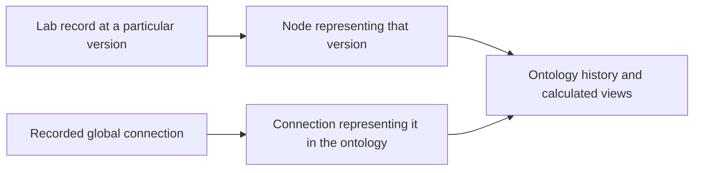

# Relationships and the wider Lab

Ontology Lifecycle keeps the history of a knowledge map. The wider Lab also
has rules about which things may be connected and what those connections mean.

These responsibilities meet, but the current code handles them in different
places. This guide explains the connection in everyday terms, then links the
source for readers who need the details.

## A connection has more than two ends

Imagine a record that says a particular policy governs an ontology node.

We need to know more than whether the node and policy exist. We also need to
know whether that kind of connection is allowed, which versions it concerns,
and which role the policy plays.

The Lab separates those questions:

| Term used in the Lab | What it means |
| --- | --- |
| Endpoint | One of the things being connected. |
| Endpoint kind | The kind of thing, such as a policy, project, or ontology node. |
| Relation Kind | A rule explaining one meaning of connection and the kinds of things it may connect. |
| Typed Relation | One recorded connection between particular versions of two things. |
| Qualifier | An extra detail needed to make the connection precise, such as a role or scope. |

For example, [governed-by](../docs/lab/reference/records/rel-relation-governed-by.md)
allows an ontology node to point to a policy and requires a detail called
`governance_role`. That records which policy applies. It does not establish
that the node complies with the policy or that an action is authorized.

## How a Lab record appears in an ontology

A node can represent a particular version of a Lab record. A connection in the
map can then represent a particular global Typed Relation.

The representation keeps a reference to the original version and a fingerprint
of its contents. That lets a reader check which original record it represents.

An ontology can also contain a connection with a meaning that belongs only to
that ontology. Such a local connection does not create a global connection
between Lab records.

The [node record format](../authority/artifact-types/ontology-node/v2/schema.json)
and [edge record format](../authority/artifact-types/ontology-edge/v1/schema.json)
describe these bindings. The edge format distinguishes a representation of a
global connection from a local interpretation.

## Is the current code using these rules?

**The Lab operational runtime checks the global rules. The Ontology Lifecycle
Rust library checks the history and consistency of its map. The full bridge
between them is not implemented in this library.**

| Question | Where the current check lives |
| --- | --- |
| Is this type of global connection declared? | Lab operational runtime. |
| Is this exact source-kind and target-kind pair allowed? | Lab operational runtime. |
| Do the named endpoint versions exist and match their identities? | Lab operational runtime. |
| Are the required extra details present, with no undeclared fields? | Lab operational runtime. |
| Is this ontology event consistent with its recorded history? | Ontology Lifecycle Rust library. |
| Are both ends of an active ontology connection active in the same map? | Ontology Lifecycle Rust library. |
| Does an assessment refer to the exact meaning version being shown? | Ontology Lifecycle Rust library. |

The Lab runtime checks a global connection before including it in confirmed
graph paths. If the check fails, it reports the problem instead of showing
that connection as confirmed.

The Rust relation record currently carries its own identity, lifecycle,
direction, and the identifiers of its two nodes. It does not yet carry the full
global connection binding or check the Lab's allowed-kind and qualifier rules.
Its active-endpoint check alone cannot establish those rules.

The Rust code's current extra-property check accepts only its selected empty
property format. Adding a new relationship name therefore does not add the
global checks needed for that relationship.

## Similar names can have different jobs

There are three relationship vocabularies in this work:

- **Global Lab connections** connect governed Lab records under declared rules.
- **Business-ontology relationships** describe the domain of this capability.
- **DomainSpec relationships** connect parts of the system specification.

A word such as “derives from” can appear in more than one vocabulary. The same
word does not make the rules interchangeable. Any mapping between them needs
to say what it preserves and which meaning it uses.

## What remains to connect in the Rust library

A complete bridge would need to:

1. Select the exact Lab record formats and connection rules it will support.
2. Record which original version each node and projected connection represents.
3. Check allowed kinds, endpoint versions, and required details before adding a
   global connection's representation to ontology history.
4. Define what happens to a representation when its original record changes or
   leaves use, while keeping the earlier history.
5. Check valid cases and reject wrong pairs, missing details, stale versions,
   and attempts to treat a local connection as a global one.

These are remaining implementation tasks. This documentation describes them
without changing the code or existing approval records.

## Source references

| Subject | Source |
| --- | --- |
| How the layers are intended to connect | [Cross-layer model](../authority/ontology-integration/candidates/0001-cross-layer-model/integration-model.json) |
| Global connection rules | [Relation Kind registry](../authority/admissions/governance-transaction-surface/v1/registries/relation-kind-registry.json) |
| Declared kinds of endpoints | [Endpoint inventory](../authority/admissions/governance-transaction-surface/v1/registries/endpoint-inventory.json) |
| Full global connection record format | [Typed Relation/v3 schema](../authority/artifact-types/candidates/0013-governance-transaction-surface/impacted-carrier-successors/typed-relation/v3/schema.json) |
| Global rule checks in code | [Lab runtime operations](../implementation/lab-runtime/v1/lab_runtime/operations.py), especially `validate_relation` and `validate_record` |
| Confirmed graph connections and reported problems | [Lab graph builder](../implementation/lab-runtime/v1/lab_runtime/graph.py) |
| Current Rust relation and endpoint checks | [Rust library](runtime/src/lib.rs), especially `OntologyRelationSemanticState` and `validate_relation_endpoints` |
| Machine-readable Rust event format | [Relation state schema](domainspec/event-sourcing/schemas/relation-state.schema.json) |
| Translation of product navigation into ontology events | [Ontology-product binding v2](../implementation/bindings/ontology-product-event-runtime/v2/src/lib.rs) |
| Domain vocabulary | [Business ontology](business-ontology.json) |
| Specification relationship rules | [Local DomainSpec registry](domainspec/relationship-registry.json) |
| Exact scope of the separate operational runtime | [Lab runtime admission](../implementation/lab-runtime/ADMISSION.md) |

The linked global registry version records 41 Relation Kinds, 109 endpoint
kinds, and 550 allowed ordered pairs. These describe the declared rules, not
the number of connections created in an ontology.

The separate operational runtime v1 uses the source baseline from Decision
0074. Later implementations and profiles need to be read through their own
records. The older [cross-layer explanation](../authority/ontology-integration/candidates/0001-cross-layer-model/INTEGRATION-MODEL.md)
and [complete-model explanation](../authority/ontology-integration/candidates/0003-definition-complete-runtime-integration/MODEL.md)
describe earlier versions of the design; their counts and task lists belong
to those versions.

Source review: **2026-11-02**, covering the Rust library, its product binding v2,
the linked Lab contracts, and operational runtime v1. This review does not
establish the behavior of every later runtime candidate or a running service.
